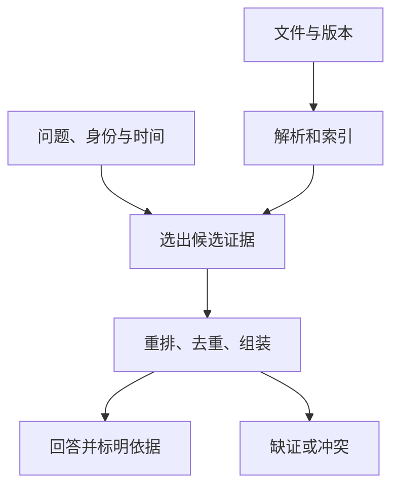

## 为什么模型记得规则，却答不出今天的政策

一条员工问题是「11 月采购的一台显示器，跨部门重分摊要走谁审批？」训练语料可能包含很多会计规则，却未必包含这家公司的当前流程。即使训练时碰巧读过内部规则，模型也没有天然的来源坐标，无法证明它说的是哪一版。一个可靠的知识问答系统必须能取到正确版本的资料，解释例外条件，并指出具体根据。找不到时，缺证本身应成为输出。

**检索增强生成（Retrieval-Augmented Generation，RAG）**把这一职责拆开。检索负责选出授权范围内的候选证据，生成负责根据提供的证据组织回答。两者之间还有排序、去重、版本选择和上下文组装。原始 RAG 论文把检索文档视为生成模型使用的外部记忆，并在模型中对文档贡献做概率边际化。工程中常见的「取前 K 段拼进提示」沿用检索增强思想，具体融合机制更简单。

## 从离线索引到在线回答

**索引**阶段先把文件转换为结构化块，再建立可搜索的片段。一个证据对象需要正文、来源 ID、版本、生效时间、章节、页码或位置，以及可追溯的访问范围。一个片段可能同时进入倒排索引和向量索引。重新入库需要替换或撤销对应版本的旧片段。面对历史询问，仍可在定义好的保留范围内检索当时有效的版本。

**检索**阶段先从业务系统推导用户身份、可见知识库及时间范围，再形成查询。候选召回强调覆盖，随后用重排和去重挑出更贴合问题的证据。业务适用性有时需要结构化判断。例如一个段落反复出现「跨部门重分摊」却只适用于研发设备，适用部门比关键词匹配更重要。

**上下文组装**还要照顾证据之间的关系。若一段给出通用规则，下一段规定金额达到阈值时的例外，两者需要一起进入上下文。把十段近似条款塞给模型可能会挤掉唯一的例外证据。可按来源做去重，并为版本、例外和表格表头保留空间。

**生成和验收**关心三件事。结论有没有回答问题，关键声明能否对应到证据，引用是否指到了能够核对的原文。让模型输出结构化的声明与来源标识后，系统可以检查标识是否存在、是否属于本次候选及版本是否有效。声明和证据在语义上是否相符，仍需抽样、规则或经校准的评估器。缺失权限、资料冲突或当前版本缺失时，输出具体的不确定性和缺少的字段。

## 用一个例子区分环节

假设候选有三条：「通用规则由接收部门经理审批」「单笔超过 5 万元加财务复核」「2024 年旧版一律由采购审批」。用户问的是当前规则且未说金额。索引漏掉通用规则是入库问题。检索只返回旧版是时间过滤或索引活跃版本的问题。召回三条但上下文只剩金额例外是组装问题。上下文有通用规则和例外，回答却断言无需财务复核，是生成阶段漏掉适用条件。相同表面错误可以起于不同组件。

## 与长上下文、微调及 Agent 的关系

语料很小、常整体阅读且权限一致时，可以直接提供完整文档。资料多、经常变更或跨权限域时，检索缩小读取范围，还能明确证据来源。微调适合反复学习稳定的输出形式或领域任务行为，随业务资料每次更新调整模型权重的成本很高，两者可以一起用。若请求只是固定问答，一轮检索已足够。需要先选政策知识库、缺证再补查预算规则或跨库核对时，可把检索包装成有预算的 Agent 能力。

## 小结

证据链需要从索引时保留出处，到查询时过滤版本和权限，再到回答时核对声明。先找出链路哪一层最早出错，再决定要改解析、召回、上下文或生成。

## 参考资料

- [Lewis 等：Retrieval-Augmented Generation for Knowledge-Intensive NLP Tasks](https://arxiv.org/abs/2005.11401)
- [Karpukhin 等：Dense Passage Retrieval](https://arxiv.org/abs/2004.04906)
