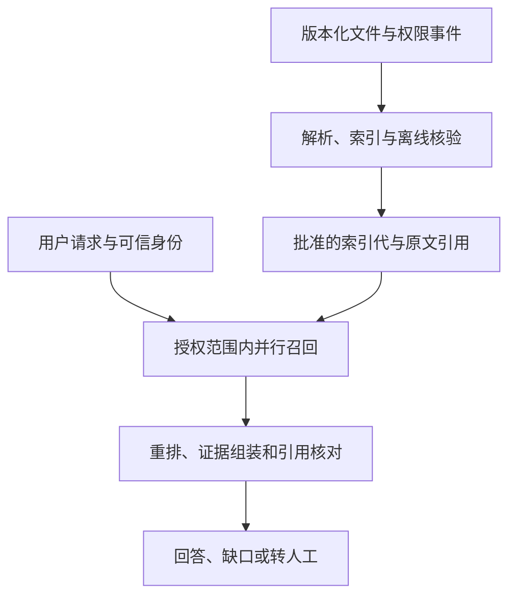

## 把知识库更新与在线回答解耦

企业有 80 万份记录，每晚更新一批，员工白天问最新流程。离线链路接收版本化文档，解析成可回查片段，写对象存储、倒排、向量索引和权限元数据。在线链路取得用户可信身份、适用生效期、索引代及查证预算，执行两路召回、融合、重排和上下文组装。生成端只使用带证据的片段，并检查最终引用。

## 索引代是一份可切换的读取契约

给一代索引记录语料快照、解析和分块版本、Embedding 模型、向量维数和度量、倒排配置、原文映射，以及权限快照的更新水位。在线读取用同一代的查询编码器和文档索引。用新模型构建第二代时先回放固定查询和授权样例，再将少量真实流量切入新代，观察候选覆盖、引用错误、延迟和成本。满足门槛后切换读别名。旧代保留至回滚窗口结束，期间仍能应用最新的撤权过滤。索引里残留旧数据时，查询与原文回读都必须按当前授权拒绝访问。

文档 ID 标识业务对象，版本标识某次内容。片段坐标属于具体版本和分块方案。若新代失败，回滚动作同时切换查询编码配置与读索引，复核原文链接和撤权。针对删除或过期文档，先在访问层使旧证据失效，再清理索引和缓存，避免后台更新延迟使系统继续引用失效版本。

## 按链路阶段计算延迟与成本

假设一次请求有 30 ms 预处理，两路召回独立用 70/95 ms，融合耗时 15 ms，20 对重排耗时 120 ms，组装 30 ms，从生成开始到首 Token 420 ms。在无排队的单次观测中，首 Token 约是 710 ms。将重排从 20 改为 10，先沿同一数据集核对覆盖和最终答案。若召回已经找到有效证据但重排等待让 P95 超出目标，可为它设分段截止时间，并降级到仍经业务校验的融合结果。上述单次估算不能代替对真实 Trace 的 P50/P95 统计。

| 优化 | 影响路径 | 同时验证 |
| --- | --- | --- |
| 查询或 Embedding 缓存 | 减少重复编码 | 查询改写与索引代、模型版本绑定 |
| 检索结果缓存 | 减少重复扫描与重排 | 权限范围、生效期和撤权 |
| 查询早退或降低重排深度 | 减少模型候选对 | 多条件问题的证据覆盖 |
| 组装去重与紧凑原文 | 减少生成输入 Token | 条款例外、原文引用和答案支持度 |

链路记录查询版本、语料和索引代、权限策略版本、各阶段证据 ID、候选数、Token 数及耗时。用聚合指标看主要成本来自哪层，出问题时用受控 Trace 追到首个错误阶段。源文件和敏感正文按访问策略管理，指标只保留排障必需元数据。

## 小结

说明哪一代资料正在被读、谁能读、证据从哪来，并给每段链路设置预算。回滚、失效和降级都应能通过真实任务和引用复核。

## 参考资料

- [Elastic 官方文档：Aliases](https://www.elastic.co/docs/manage-data/data-store/aliases)
- [Faiss 官方文档：Indexes](https://github.com/facebookresearch/faiss/wiki/Faiss-indexes)
- [OpenTelemetry 官方文档：Traces](https://opentelemetry.io/docs/concepts/signals/traces/)
