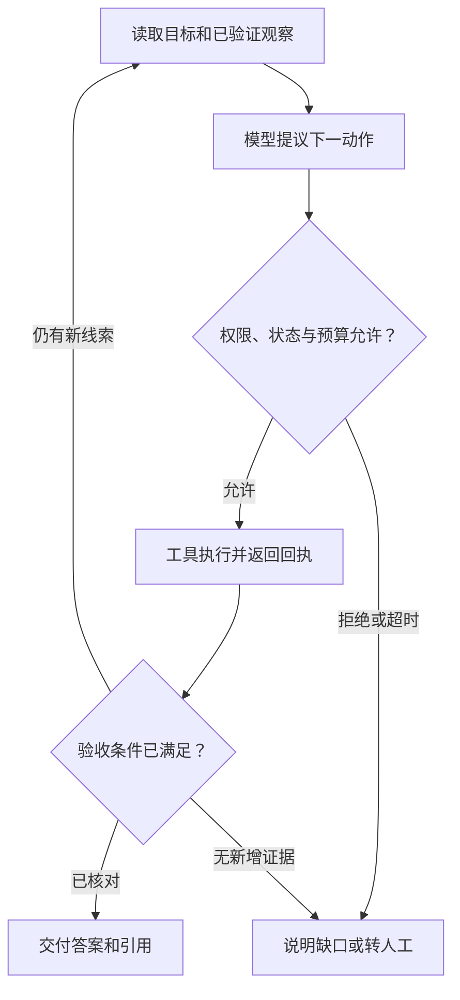

## 一次检索只能找到旧手册时

设备报 E-7429。助手第一次查到 2023 版手册，适用固件 2.x。工具回执同时表明这台设备运行 3.x。旧版手册可以帮助识别错误类别，却不能直接用于处理这台设备。ReAct 把检索结果作为观察，允许模型根据实际证据提议下一动作，例如限定固件版本继续查。执行权、权限和停止标准仍在宿主。

### 一个可操作的循环协议

状态保存当前目标、可见工具、回执 ID、已用步数和终止原因。动作带参数和调用 ID，观察带来源、状态和版本。遇到「无命中」时，可以改写查询，但若规范化后仍等价且同一索引代已经查过，应结束这条路径。遇到「无权限」，可以说明缺口或请求用户提供适用材料，避免把授权判断当成普通搜索失败。

| 步骤 | 观察 | 下一次选择 |
| --- | --- | --- |
| 1 | 旧手册适用 2.x，设备运行 3.x | 限定型号和固件重查 |
| 2 | 现行文档含恢复时间但缺设备子型号 | 向设备台账读取子型号，或请用户确认 |
| 3 | 子型号命中同版本条款 | 审查引用后交付 |
| 异常 | 查询重复、证据仍冲突或预算用完 | 返回已有证据和待补条件 |

当答案只需查一次明确字段，固定查询的耗时更可控。目标复杂、有多条依赖时，使用 Plan-and-Execute 定义宏观路线，再让一个查证节点执行有限的 ReAct。将原始工具回执留在受控记录中，传给模型的是当轮所需的观察和来源。循环结束后把退出类型分层统计，检验新增检索是否实际改善了覆盖或完成率。

## 小结

ReAct 用观察更新行动。可靠系统要为每步明确权限、预算、可核对回执和停止条件，并能解释为什么继续或结束。

## 参考资料

- [Yao 等：ReAct](https://arxiv.org/abs/2210.03629)
- [Anthropic：Building effective agents](https://www.anthropic.com/research/building-effective-agents)
