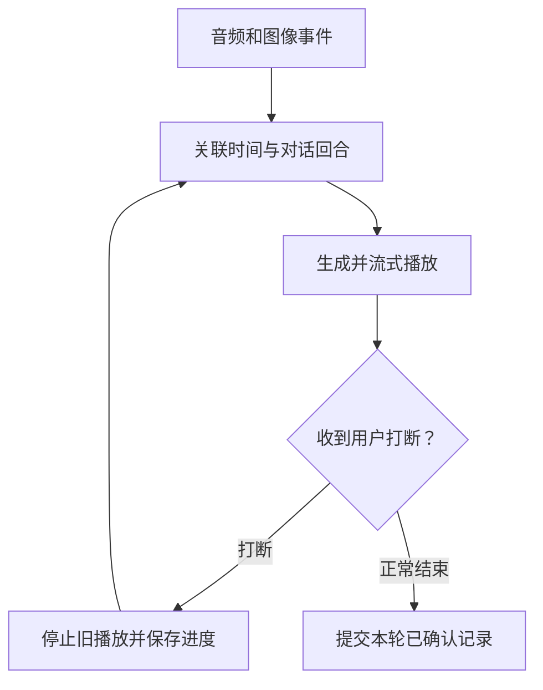

## 为什么实时速度并非只由模型决定

用户给出一张设备手册截图并问「这个灯是什么意思」。系统把图像版本、音频回合和回答关联起来。语音采集、回合检测、模型、输出缓冲和播放共同影响交互。可用分阶段识别与合成，或直接语音交互。选型关注可观察性、时延、业务词汇准确率和可控的打断。

## 一次打断需要维护哪几份状态

模型已生成两句音频，用户只听完第一句便说「我是指右边」。客户端清理未播内容，发送必要的取消或截断事件，并保存实际播放位置。下一轮用新指代和当前图像重新决定内容。外部动作的状态与播放分离，独立核对授权和回执。高影响操作要有明确的确认界面或语义。

## 能力与验收

已有实时模型与 API 支持语音流和多模态输入。不同产品的事件语义、支持模式和延迟需按版本实测。建立固定用例覆盖打断重叠、静音、网络抖动和图像替换，分别观测首音频延迟、截断后残留播放、指代准确和完成率。

## 小结

实时体验来自正确的事件关联与播放控制。以实际听到和实际执行的两个状态分别验收。

## 参考资料

- [OpenAI：Realtime API](https://developers.openai.com/api/docs/guides/realtime)
