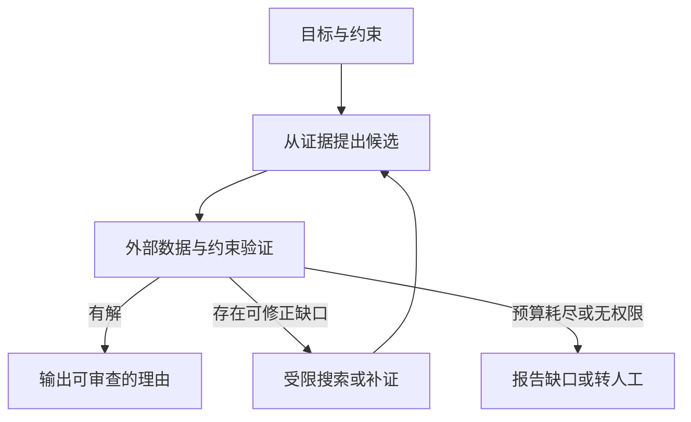

## 推理处理该相信哪个结论，规划安排接下来做哪些事

助理要为 10 人选一个会议室。要求在 14:00 后开始、全员有 45 分钟空档、会前准备 10 分钟，并优先不移动已有设备。任务计划可以列为「查人员时间 → 查房间可用性 → 筛选 → 提供建议」。推理发生在筛选：把人数、时间区间、房间容量、准备时间和设备偏好组合成可核对结论。模型可以从自然语言提取候选条件，环境和检查器提供真实可用性。

输出时保留可审查的约束、证据、计算结果和决策理由。逐字的内部思维过程无法代替这些内容，也没有必要把私人推理轨迹存入系统。对于可精确计算的检查，让确定性程序直接算交集和边界。对于口语里「2 点过一点也行」这样的表述，可先请用户确认允许范围。

## 同一批数据怎样生成、验证并修改候选

已确认全员空闲 14:10–15:20。A 室容量 8，在 14:00–16:00 空闲。B 室 12 座，14:20–15:30 空闲但需搬设备。C 室 12 座，自带设备，14:30–15:30 空闲。A 因容量淘汰。B 可以先占用 14:20–14:30 准备，在 14:30–15:15 开会。C 最早 14:40 开会，45 分钟后是 15:25，超过全员空档。B 是当前数据下的可行建议。若额外收到可靠回执说 C 免准备，即可重新评估 C。若工具查不到全员数据，则返回待确认。

## 选择推理机制时看失败发生在哪里

| 机制 | 如何组织候选 | 代价或前提 |
| --- | --- | --- |
| 分步推断（CoT 类） | 把复合问题转成可查的中间结论，交付关键证据和计算 | 早期前提错误可传到后面 |
| 自一致性 | 多次采样后按可比较的答案聚合 | 计算随样本数增长，各样本可共享偏差 |
| ReAct | 用行动取回实时观察，按回执更新下一动作 | 需要可查环境、工具权限和停止标准 |
| Reflection / Self-Correction | 根据错误证据检查和改写候选 | 自评可重复相同错误，需要独立反馈 |
| Tree of Thoughts | 在树上保留多个部分方案，评分、扩展或回退 | 需要可评估的部分状态，分支扩大可能迅速耗尽预算 |
| Graph of Thoughts | 把中间贡献建成图，允许汇合和复用 | 需要等价判断、合并规则和有界循环 |

以宽度 3 的逐层搜索为例，每层为每个保留候选展开 4 个新候选，则一轮最多需评分 12 个候选。工作流要根据截止时间、工具预算和预期收益限制层数，优先合并语义等价方案。对同一业务决策，分别记录生成次数、验证器成本、成功率与拒绝率。若会议室问题完全可表达为区间约束和排序，确定性检查通常已经足够。自然语言约束含歧义或需要逐步查证时，再引入模型候选与动态工具调用。

## 小结

用规划组织工作，用推理形成并对照候选，用宿主检查器判定可验收结果。提高可靠性的关键输入是真实、独立、可核对的反馈与明确停止条件。

## 参考资料

- [Yao 等：ReAct](https://arxiv.org/abs/2210.03629)
- [Wang 等：Self-Consistency](https://arxiv.org/abs/2203.11171)
- [Yao 等：Tree of Thoughts](https://arxiv.org/abs/2305.10601)
- [Besta 等：Graph of Thoughts](https://arxiv.org/abs/2308.09687)
