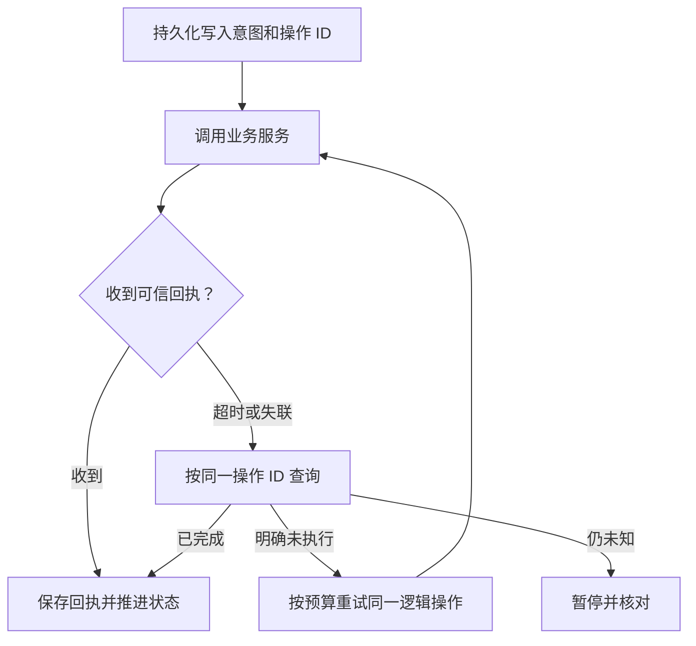

## 工单服务超时后，重复提交可能开出两张单

Agent 已经通过核对并向工单系统发送创建请求。该服务已经成功写入，但回响应前连接断开。调用方只看到超时。重试通常能缓解暂时故障，但直接重复有副作用的请求可能创建第二张工单。生产系统必须能表达「尚未执行」「明确失败」「已执行」「结果未知」四种不同状态。超时只提供通信观测，有时不能判断业务结果。

## 同一逻辑操作拥有同一个幂等键

对任务中的每次业务写入生成稳定标识，例如任务 ID 加操作 ID，将目标、动作、授权记录和规范化参数的摘要一并持久化。后台业务服务以键去重。第一次成功后，再收到同键、同语义参数时返回原回执。相同键、不同参数表示冲突，应拒绝或进入核对。不能把模型生成的随机 ID 当成每次重试的稳定操作标识，也不能只用任务 ID 使多次不同写入互相覆盖。

如果业务服务的去重记录与实际写入不能在同一原子边界提交，就仍可能出现记录有而对象没有，或对象有而记录没有。服务可用同一数据库事务登记键并写业务对象；跨服务时需要下游可查询的稳定业务标识或协调流程。仅调用方保存幂等键不会迫使不支持幂等的后端去重。

## Checkpoint、Outbox 和补偿承担哪些责任

Checkpoint 保存工作流在何处以及可用的状态，并不证明外部写操作成功。可持久化「准备写入」意图，再交给后台 Worker 调用。若还要把本地事务的变更发布到消息系统，可用 Transactional Outbox，在同一个本地事务提交业务变更和待发消息。转发器仍可能重复发布，下游需要按事件 ID 去重。Outbox 解决本地变更与通知的可靠关联，跨系统的外部动作仍依赖对应服务契约。

某些数据变化可以在业务层补偿，例如取消未受理的重复工单。邮件已经发送、信息已对外可见等副作用无法被简单撤销。补偿本身是新的业务动作，需要授权、幂等和回执。失败不可自动分类时应保留待人工处理并附证据。

## 重试预算怎样设计

给每次请求设截止时间，再给任务设总预算，防止多层 HTTP SDK、队列和执行器各自反复重试。对容量波动等临时错误使用指数退避加随机抖动。权限错误和合法性校验失败通常要修正输入或流程。限流尊重服务端返回的等待提示，并控制在任务期限内。为「响应丢失但写入成功」设计恢复样本，也测试重复消息、并发 Worker、重启和键保存过期。验收以实际外部数据、应用状态和回执一致为准。

## 小结

外部副作用以可信回执验收。把确定失败和结果未知分开，提供有业务语义的幂等键与查询能力，再用持久化意图、重试预算和人工路径补齐恢复。

## 参考资料

- [AWS Builders’ Library：Making retries safe with idempotent APIs](https://aws.amazon.com/builders-library/making-retries-safe-with-idempotent-APIs/)
- [AWS Prescriptive Guidance：Transactional Outbox](https://docs.aws.amazon.com/prescriptive-guidance/latest/cloud-design-patterns/transactional-outbox.html)
