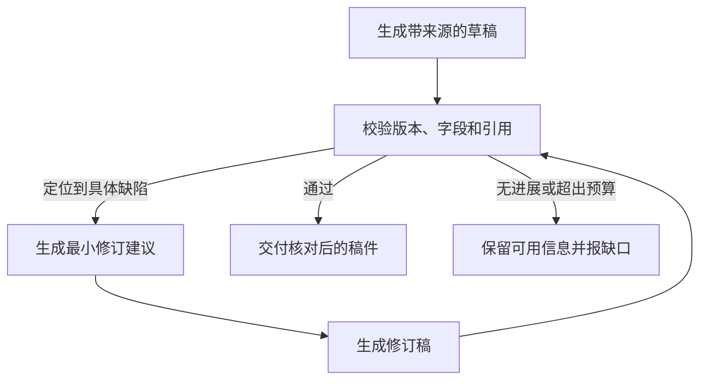

## 从一句「再检查一下」到可定位的修订

助手草拟采购合规说明，引用条款 P4 并推荐审批人。核对服务发现 P4 过期，当前可见条款 G7 调整了金额线。Reflection 对候选产物生成有针对性的反馈，再修改候选重新验收。关键输入是可证实的缺陷和影响范围。允许模型根据证据重拟表述，不能用模型自评补齐不存在的事实。

检查器给出问题代码 `source_expired`、位置「第 2 条」、观察版本 P4、新证据 G7、允许调整的字段以及停止预算。修订只替换受影响结论，保留其余已核实引用。修订后重新检查全部引用，以防修正某一字段时破坏其他条款。

### 哪些反馈来自规则，哪些适合让模型处理

| 反馈 | 建议职责 |
| --- | --- |
| 条款撤销或版本超期 | 权威元数据和规则判断 |
| 结论与原文事实冲突 | 以明确条款比对，复杂语义加人工抽检 |
| 表达难理解 | 模型或人工提供修改建议 |
| 缺少业务决策所需事实 | 有授权时补证，否则报告缺口 |

轮次内保存初稿、修订前后差异和验收结果。失败反馈如果涉及根本前提，应递交规划器处理，而非重复修改文字。对于开放主题可用 Reflection 辅助发现遗漏。确定字段和引用校验可以直接由工作流拒绝，节省额外模型调用。

## 小结

Reflection 将可证实反馈变成有范围的修订。有效性来自独立核查、可比较的候选和明确退出，不取决于生成多少轮解释。

## 参考资料

- [Shinn 等：Reflexion](https://arxiv.org/abs/2303.11366)
- [Anthropic：Building effective agents](https://www.anthropic.com/research/building-effective-agents)
