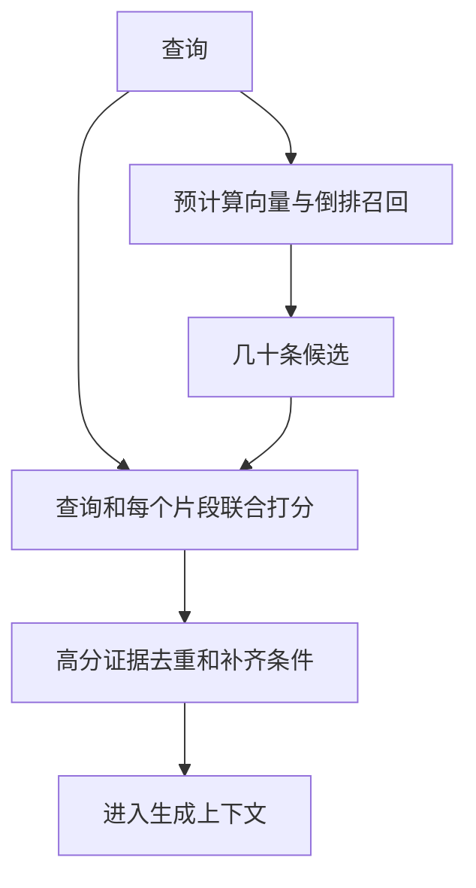

## 为什么主题相近的段落排在真正证据前面

查询「超过 5 万元的跨部门固定资产调拨由谁复核」。召回列表第一篇标题是「固定资产采购审批」，出现「5 万元」「财务复核」「固定资产」，但动作是采购。另一段标题「跨部门调拨」出现相同金额，正文才是所需证据。一个需要精确对齐动作、金额和条件的判别器，可以在几十条候选上表现出比全库高吞吐召回更细的区分能力。这就是两阶段检索的主要原因。

## Bi-Encoder 与 Cross-Encoder

Bi-Encoder 分别编码查询和文档，用预计算向量快速搜索。Cross-Encoder 将查询和候选文本作为同次模型输入，允许在各层计算 token 之间的相互作用。模型可以发现问题中的「调拨」与段落中的「采购」冲突，或者引用句有关键否定。输出通常是相关性分数，可由成对相关样本、排序标签或蒸馏信号训练。分数衡量模型定义的相关性，不天然是概率，也不保证满足版本和授权规则。

| 属性 | Bi-Encoder | Cross-Encoder |
| --- | --- | --- |
| 在线输入 | 查询一次，文档向量预计算 | 每个查询与候选组成一个输入对 |
| 对齐能力 | 最后在整体表示上比较 | 输入序列内部可以显式交换信息 |
| 典型工作量 | 一次编码加索引搜索 | 候选数个输入对，批处理影响吞吐 |
| 适用阶段 | 大集合召回 | 小集合细排 |

## 候选数、截断和延迟从哪里来

重排器最多挽救已经召回的有效证据。一个系统取 30 个候选用于重排，最终只送 6 个。候选 Recall@30 先告诉你这 30 个有没有可用证据，nDCG@6 或证据覆盖检验前排质量。比较 30、60、100 个候选时，固定召回输入和重排器版本，记录候选 Token 分布、批处理耗时、每类问题的增益及 P95。交互请求可设有截止时间的重排，并使用有记录的融合排序作为降级。提高候选数可能改善上限，也可能把更多相似干扰项引入小模型的排序。

拼接 query 与正文后有输入长度限制。若段落前 300 Token 是概述，例外在末尾，模型截短后重排依据不足。可按句段做多窗口打分，或输入含标题、金额与上下文的短证据片段，命中后再回读父块。多窗口取最大值会偏好长文档有更多机会高分，合并时应在评估里做长度分层。

## 重排与上下文组装怎样分工

如果前五条都是同一规则的重叠窗口，重排可能从相关性看没有错，生成却没有获得唯一的例外。组装阶段应按证据和父文档去重，保证多条件问题的证据覆盖，并用来源 ID 标记哪个片段支持哪个结论。权限、型号、生效日期等确定性条件优先通过过滤保证，避免把业务正确性完全留给评分模型。

## 小结

重排用更贵的成对模型区分细粒度相关性。召回深度决定可选择的证据，截断决定读到的信息，组装决定证据最终能否完整进入生成。

## 参考资料

- [Nogueira 与 Cho：Passage Re-ranking with BERT](https://arxiv.org/abs/1901.04085)
- [Sentence Transformers 官方指南：Retrieve & Re-Rank](https://sbert.net/examples/sentence_transformer/applications/retrieve_rerank/README.html)
