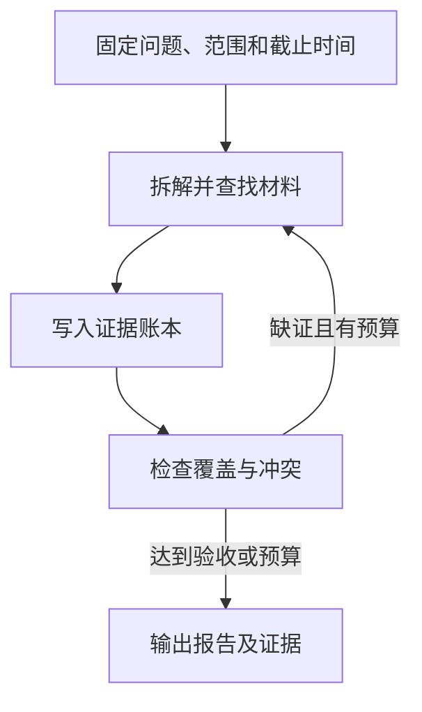

## 研究问题先变成验收条件

假设团队要比较两种内部文档检索方案，关心引用质量、数据访问控制和更新成本。输出为三维比较表及证据索引。应用先把任务拆为三个子问题，为每项声明适用时间、首选证据和缺证策略。金额、性能或兼容性若只得到营销说法，用「未验证」表示。

## 查询、取证和综合怎样配合

搜索发现来源，读取阶段核对发布方、日期、版本和原文。将来源 ID、原文定位、主张草案及限制写入账本。例子中方案 A 的延迟来自 100 条合成查询，方案 B 的延迟来自实际高峰，两者不能直接判输赢。综合阶段可以先展示两个运行条件，并提出同负载复测。引用是供读者核查的一部分，不能用无证据的措辞掩盖差距。

研究 Agent 可为不同维度并行派发查证；资料不足的维度允许再查。浏览仅访问获授权的公开资料或内部范围，模型不根据网页文字改变系统任务。以预算、截止和可验证覆盖决定何时停。保存搜索词、已读来源和未解决问题，恢复时避免重复消费相同资料。

## 用失败样本验收

将过时文档、两个相似但版本不同的事实和只有摘要没有原文的来源放进受控素材。检查报告标出未覆盖维度、保留冲突、合并重复来源，并让读者能够从比较表走到引用。记录有效引用比例、覆盖和耗时。若某个结论依赖缺失数据，即使表格完整也应降为待证。

## 小结

研究助手的可交付物包括报告与证据账本。查询负责找材料，综合负责解释可比较性，预算和缺证规则保护研究范围。

## 参考资料

- [Anthropic：Building effective agents](https://www.anthropic.com/research/building-effective-agents)
