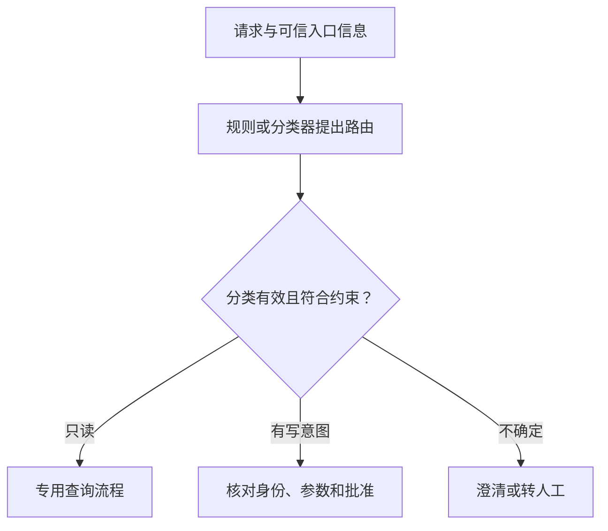

## 按一次分类进入不同业务路径

客服输入可能是「发票发哪了」「请核对报销上限」或「帮我向经理提交申请」。把它们全部塞给同一个工具循环，代价是候选过多且路径难解释。Router 先输出允许路由集合中的结构化标签，宿主接下来调用专门流程。可以优先使用可信表单来源等确定字段，再为自然语言入口做分类。允许 `unknown` 与 `needs_clarification` 两个有效去向。

路由契约记录候选标签、分类依据、是否要追问以及不确定原因。分类器可以识别请求包含问答和草稿两个意图，由上层按依赖安排。系统不应根据「提交」两字做写操作，句子「已经提交了吗」更可能是查询。对长期含糊样本，在输入中加入会话上下文，提高分类准确度仍需回归验证。

### 用混淆矩阵决定成本在哪

假设有 100 条请求，90 条是查询，10 条想提交。若模型全判为查询，准确率 90%，实际提交召回率为 0。若模型把 2 条查询误判为提交，写意图误报需要独立计数。实际写入有业务授权拦截，分类失误和真正策略误执行应分为两层指标。用回退率、任务成功、人工成本及误路由损失评估阈值。适合规则的类别继续用规则，边界含糊才交给模型或人工。

当类别内部需要多步证据，可由 Router 选中 ReAct 或固定流程。分发之后记录路由版本、预测标签和实际验收结果。新增类别时验证旧读者能处理未知值，避免默认分支错误触发业务动作。

## 小结

Router 缩小请求处理范围，分类概率和业务许可分开校验。以混淆矩阵、可解释回退和任务实际结果检验路由收益。

## 参考资料

- [Anthropic：Building effective agents](https://www.anthropic.com/research/building-effective-agents)
- [JSON Schema：Enumerated values](https://json-schema.org/understanding-json-schema/reference/enum)
