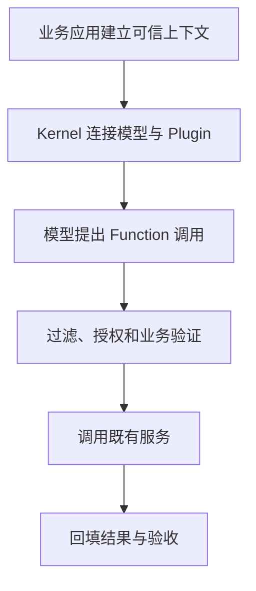

## 为什么企业应用先封装一个窄业务接口

一个 .NET 内部应用已有报销服务和认证中间件。它希望让模型查单并解释状态。Semantic Kernel 的 Kernel 将 AI 服务与可用插件组织在一起。Plugin 将一个或多个 Function 描述为可调用能力。本地代码可提供确定的服务调用，Prompt Function 则用提示模板和模型形成输出。角色与权限由应用创建可信上下文，模型只填业务参数。

## 从参数到业务结果的边界

以 `get_expense_status(id)` 为例，Function 的描述写清它查什么、允许何种编号。业务适配器使用当前身份核对资源，并从真实服务返回结构化状态。Kernel 的过滤器可以在支持的调用路径记录元数据或拦截不允许的调用。应用仍需确保所有写接口都有独立验证，避免在单一路径拦截却可以从另一入口执行。

当要编排「导入、核对、生成说明、可选审批」，Process 用步骤、事件和状态表达显式业务过程。单个 Agent 则可使用工具并围绕会话做有限决策。若在同一系统组合两者，把审批、金额规则放在明确流程里，让 Agent 只负责语言解析或建议。微软将这里的 Process Framework 标注为实验性。跨语言 SDK 的功能和稳定性可能不同，先核对自己固定的包和文档。

## 从旧系统迁移的最小验证

先将一个只读 Function 封装为窄 Plugin，测试无权限、无数据、正确结果三类回执。再加入调用记录和可回放的样本。若后续迁移微软 Agent Framework，保持业务服务接口、结果验收和证据 ID 稳定，单独更换编排层。这样可以识别行为差异来自插件适配、工作流还是模型。

## 小结

Semantic Kernel 连接模型和已有业务能力。Kernel 管集成，Plugin 和 Function 表达可调用工作，Process 描述显式流程，真实事实和动作批准由业务服务管。

## 参考资料

- [Microsoft Learn：Semantic Kernel](https://learn.microsoft.com/en-us/semantic-kernel/overview/)
- [Microsoft Learn：Semantic Kernel Plugins](https://learn.microsoft.com/en-us/semantic-kernel/concepts/plugins/)
- [Microsoft Learn：Process Framework](https://learn.microsoft.com/en-us/semantic-kernel/frameworks/process/process-framework)
- [Microsoft Learn：Microsoft Agent Framework](https://learn.microsoft.com/en-us/agent-framework/overview/)
