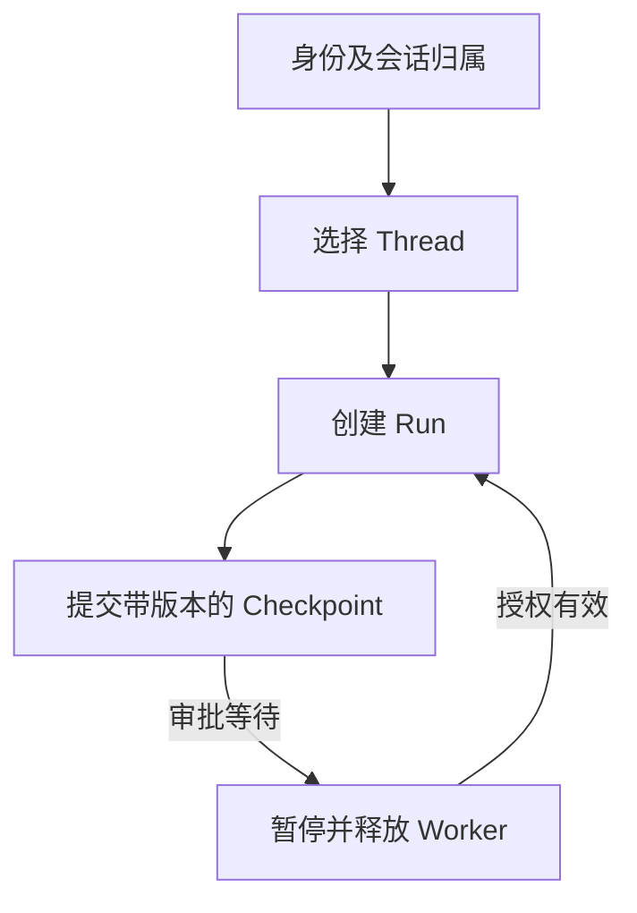

## 用户看见一段对话，系统维护多种状态

员工上午查差旅规定，并留下一份待审批草稿。下午另开对话询问客户招待。批准上午草稿的人可能是业务审核员，应用的登录会话可能也已刷新。若把这些对象共享同一个 ID，恢复时容易串用聊天、权限和任务状态。不同框架的命名会有差异，项目应先写清对象关系。

| 概念 | 示例含义 | 常见寿命 |
| --- | --- | --- |
| Session | 应用级交互容器，归某个主体 | 可跨多次请求 |
| Conversation | 用户可读的消息与引用 | 由产品保存和清理策略决定 |
| Thread | 编排状态与历史快照的关联范围 | 可包含多个 Run |
| Run | 一次具体图调用、恢复调用或任务触发 | 从开始到已完成、失败或中断 |
| State | 当前阶段、证据、待办与操作身份 | 随事件更新 |
| Checkpoint | 可恢复位置与一份状态快照 | 使用后端的保留与版本策略 |

## 防止迟到事件推进新状态

设草稿在 v7 等待同意。取消请求与批准同时到达。存储可以按「期望 v7 且当前处于等待」做原子条件更新。若取消先成功成为 v8，批准请求应返回冲突并读取当前状态。若批准先到达，批准也不代表外部提交已完成。执行前再次确认批准内容、当前身份和目标资源。业务回执独立保存，用来核对未知结果。

读取进度时可以使用缓存。涉及审批和写入的判断应从权威状态确认。恢复先找到可见 Thread，再加载其检查点、未完成工作项、预算及已执行副作用。长期记忆独立保存用途与撤回状态。线程清理不应该让合规要求保留的审计回执一起丢失，需要分别制定策略。

## 小结

会话、任务和运行有各自归属。以版本控制并发更新，以检查点恢复过程，以业务回执确认实际副作用。把三者分开后，线程恢复和数据清理都更容易验证。

## 参考资料

- [LangGraph：Persistence](https://docs.langchain.com/oss/python/langgraph/persistence)
- [PostgreSQL：Transaction Isolation](https://www.postgresql.org/docs/current/transaction-iso.html)
