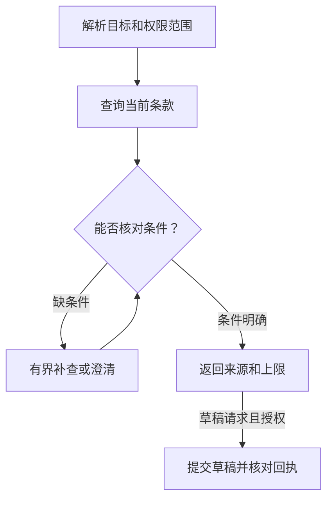

## 从一条报销咨询拆出三个不同目标

员工说「下个月去苏州参会，住宿能报多少？能帮我建个申请草稿吗？」系统先要识别地区和时间，再查现行条款，还可能需要创建草稿。从架构角度，最先明确三件事：谁组织检索和业务操作，哪些状态必须在模型调用之外持久化，什么条件可以判定完成。写入草稿成功，以业务回执为准。回答金额上限，以当前身份可读的生效条款为准。

### 同一任务为什么会演化出不同结构

| 架构 | 模型可选择的内容 | 主要失败与判断 |
| --- | --- | --- |
| 简单 Agent | 从有限动作中决定回答、澄清或停止 | 只适合观察和动作状态较少的任务，先核对是否需要真实外部数据 |
| Tool-Calling / ReAct | 可提议查询工具，收到回执后重选动作 | 要处理乱序、无效参数、重复观察和循环上限 |
| Planning | 先产出带依赖的任务，再由执行器推进 | 计划前提失效时须作废相关下游产物 |
| Reflection | 根据校验结果修订候选，宿主持有退出规则 | 缺少独立反馈时可能反复改写同一错误 |
| RAG | 引用检索提供的授权证据，检索轮次可由宿主或模型选择 | 精确证据可能在采集、召回、重排或组装阶段丢失 |
| Memory | 在当前任务中取用可撤回的偏好或经历 | 过时、低置信或作用域不同的记忆会污染当前判断 |

这些是可组合的职责。可以设计一个只读 RAG 阶段，由固定流程查政策。只有遇到例外且证据缺失时，打开一个有预算的工具循环。用户明确请求建草稿时，通过权限与审批后进入独立写入阶段。供应商轮换、复杂演进或多依赖任务再引入规划。

### 先验证三条路径

明确地区和日期的请求走一次查询。若政策缺少区县例外，模型可提出一次更窄的查询，但运行时检查重复查询和总预算。若授权失效，系统可以交付已核实的政策说明，草稿步骤返回明确结果。分别记录读取、业务验收和草稿写入这三个结果，避免用一个「成功」覆盖实际差异。

例如 100 条咨询中 80 条可直接匹配只读条款。给每条都加一次 Planner 会增加 100 次规划请求。只对经验证确需多步的 20 条启用规划，可以用相同回归数据区分规划收益和路由漏判。实际架构要看处理复杂任务的增益、遗漏代价和运维成本。

## 小结

先确定哪段需要模型决策，再选择工具、计划、反思、检索与记忆的组合。评估应覆盖缺证、权限变化、已执行但回执超时和早停四类路径。

## 参考资料

- [Anthropic：Building effective agents](https://www.anthropic.com/research/building-effective-agents)
- [Yao 等：ReAct](https://arxiv.org/abs/2210.03629)
