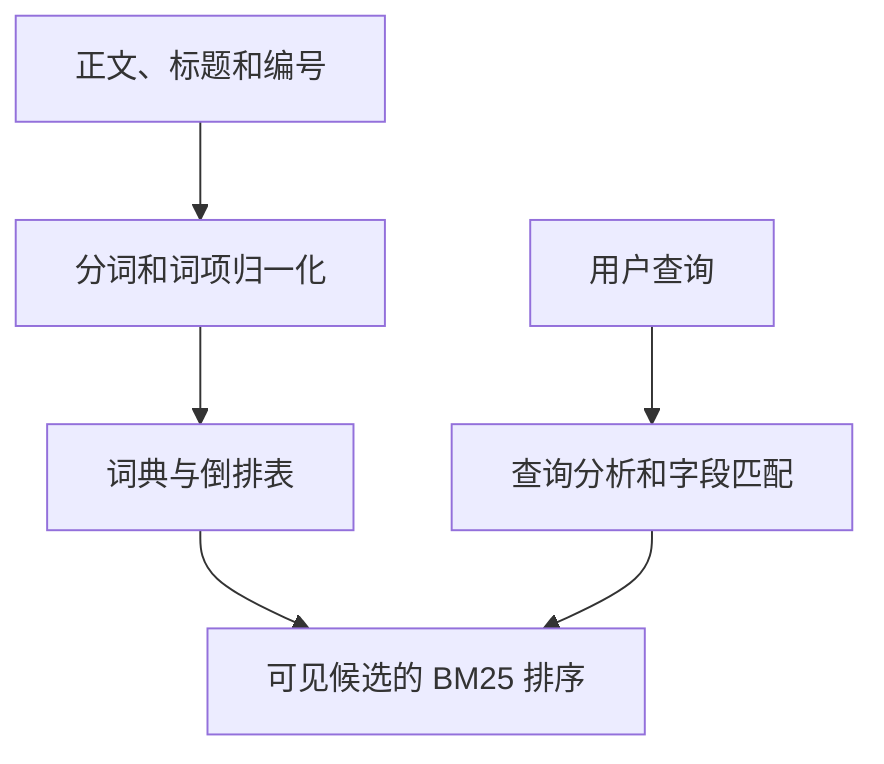

## 型号、条款号和罕见术语为什么值得精确搜索

「报错 E-7429 怎么处理」与「报错 E-7428 怎么处理」只有最后一个字符不同，却很可能需要两篇手册。向量相似性可能认为两个问题几乎一样。词法检索能够保留这种精确区分，并利用罕见标识对相关文档的强指示性。稀疏检索的经典形式把文档映射到词项空间，大部分维度为空，只访问问题中出现的词项。

## 倒排索引把遍历文档改成遍历词项

正排记录「这篇有哪些词」。倒排记录「这个词出现在哪些文档」。词典中每个 term 对应 postings list，里面通常有文档 ID、词频，可选词位置信息。短语「财务 审批」可用两个词的位置关系核对。时间与权限过滤可以使用可见集合和 postings 求交，之后仅给匹配候选算分。词项很常见时 postings 很长，实践中检索器可利用分数上界提早跳过一些不可能进入前 K 的候选。

## TF-IDF 到 BM25

**TF** 衡量某词在本文档出现多少次。**IDF** 反映该词在语料中多稀有。每篇都出现的「系统」区分力低，只在一种设备规格出现的型号区分力高。TF-IDF 有多种具体处理形式，常见搭配是对数词频和余弦相似度。BM25 直接给查询与文档做词项打分，常见实现中每个词项的贡献可写作：

> IDF(t) × [f(t,d) × (k₁ + 1)] / [f(t,d) + k₁ × (1 − b + b × |d| / avgdl)]

这里 f 是词频，长度和平均长度按索引字段的词项计数，k₁ 控制词频饱和，b 控制长度归一化。若 b=0，相同词频的两篇文档不因长度不同变分。b 大时，长文档用更高词频才能取得相同的单词项贡献。例如 k₁=1.2、文档恰好平均长时，出现一次的 TF 因子为 1，出现三次约 1.57，出现十次约 1.96，继续重复的收益逐渐减小。常见 IDF 还会按文档数和词的文档频率做平滑，具体公式要看搜索引擎。

## 中文、编号和字段

中文中空格通常不标词边界。「固定资产调拨」可在字段里用分词保留「固定资产」「调拨」，并另用字符 n-gram 处理未知词。中文人名、缩写和新型号不能总靠通用分词。可建立不切分的型号字段，用规范化的大小写或连字符支持精确匹配，同时让标题、段落和同义词留在文本字段。查询端与索引端必须共享必要的规范，否则索引只存了「E-7429」，查询被切成「E」和「7429」后无法在精确字段命中。中文、英文、繁简以及数字单位也可根据语料做明确定义的转换，保留原文供引用。

领域同义词适合固定业务词，例如「调拨」和「转移」。把含义相近但范围不同的词全等价化，会产生难诊断的误召回。对问题里明确的编号、产品和版本可优先执行结构化过滤或精确匹配，再让向量召回补齐口语改写。

## 小结

倒排索引让检索从词项进入文档，BM25 用稀有度、饱和词频和长度校正决定排序。它为编号和术语提供强信号，语义改写仍需要同义词或向量等手段补齐。

## 参考资料

- [Apache Lucene：BM25Similarity 参数与 IDF](https://lucene.apache.org/core/9_12_2/core/org/apache/lucene/search/similarities/BM25Similarity.html)
- [SQLite FTS5：BM25 与文本索引](https://sqlite.org/fts5.html)
