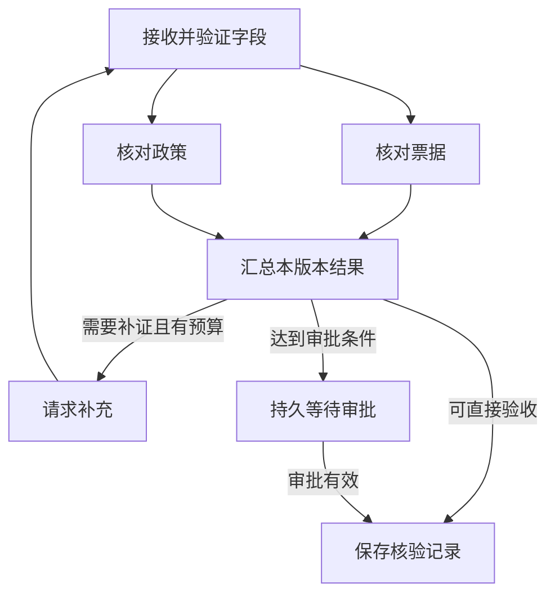

## 把一次报销核验写成有状态的图

上传报销资料后，程序先验收字段，再并行核对票据金额和制度条件，必要时等待人工，最后生成核验记录。图有四个可验证的组成部分。节点读取一份确定版本的输入并产生部分结果。边表示允许的迁移。状态持有任务事实和待处理项。条件边根据验证结果挑选路径。

### 并行返回顺序会怎样改变结果

任务版本 v5 并行运行 `receipt` 与 `policy`。若两个节点都写 `status`，较晚的「查询成功」可能盖掉先到的「票据有差异」。可以按 `run_version + branch_id` 分别写入 `receipt_result`、`policy_result`。每个分支拥有明确返回状态，合流根据启动时保存的分支集合验收。重复结果按稳定 ID 去重，不同版本结果隔离。若分支可选，由启动器声明其是否进入本次集合，避免合流无期限等待。

| 条件 | 状态迁移 | 存储要点 |
| --- | --- | --- |
| 两路均有效 | 汇总后进入验收 | 存回执和政策版本 |
| 票据不完整 | 转等待补证 | 给出明确缺口和截止时间 |
| 制度服务超时 | 有预算时重试 | 不重复执行已成功分支 |
| 人工审批后金额发生变化 | 原审批失效 | 重新绑定当前金额和版本 |

工作流保存的是可恢复控制状态。运行节点的外部写入要有自己的幂等键或可信回执。保存业务记录前进程挂掉，与业务记录写成功后进程挂掉，可能看起来同样停在同一节点。恢复先核对回执，必要时用同一业务操作标识重新确认，避免重复创建。

### 用失败路径审查图

对循环定义最大次数、缺证类型和最晚结束时间。审批用显式等待状态，有拒绝、过期和取消出口。状态转移应可由旧版本事件重放，最先测试分支重复、乱序、超时和任务版本并发更新。固定流程能围住高影响步骤。动态查证可存在于有界节点里，状态图仍提供外部观察和业务验收。

## 小结

把工作流写成可核对的状态迁移。并行分支单独保存结果，合流按任务版本验收，循环和人工等待有明确出口。

## 参考资料

- [Anthropic：Building effective agents](https://www.anthropic.com/research/building-effective-agents)
- [LangGraph 官方文档：Graph API](https://docs.langchain.com/oss/python/langgraph/graph-api)
