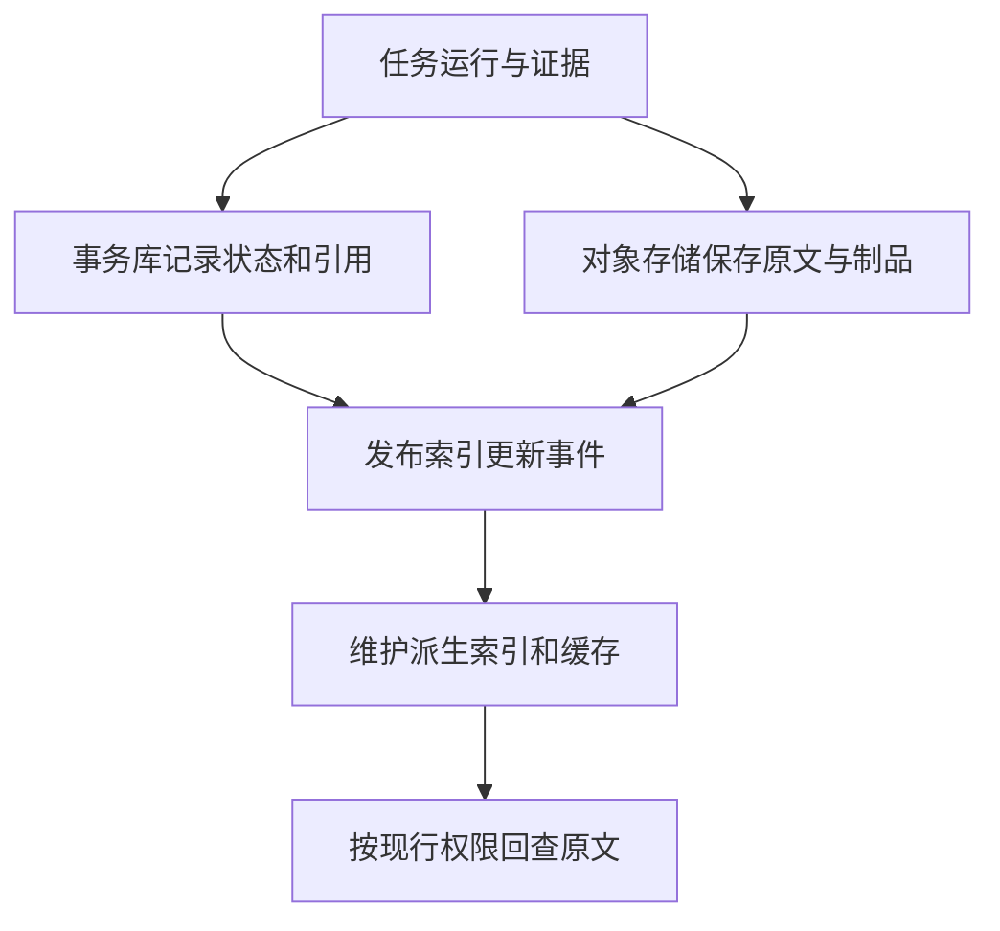

## 一份核查结果为什么需要四类存储

核查过程中有任务进度、证据片段、生成的大文件和短期统计。将它们全写到同一种存储，可能为一个查询方便损失可靠性。先为每类数据指定权威记录，再按访问模式引入缓存和派生索引。

| 数据 | 权威或服务位置 | 关键约束 |
| --- | --- | --- |
| 会话、任务、版本和回执 | PostgreSQL 等事务库 | 原子迁移、唯一键、保留规则 |
| 短期缓存和临时计数 | Redis 等内存服务 | TTL、驱逐、按租户隔离 |
| 原始附件和大型制品 | 对象存储 | 内容摘要、版本、受控读取 |
| 文档块的语义索引 | 向量索引 | 可再生、模型和语料版本绑定 |
| 偏好和纠正历史 | 可访问控制的记忆存储 | 确认、时效、可撤回 |

## 让跨存储写入可以恢复

例如生成汇总表后，先将内容上传至临时对象，核对摘要。数据库用事务提交产物引用、任务状态和通知事件，最后让读取层公开已提交引用。进程若在上传后、数据库写入前退出，临时对象可以按操作标识重新关联，也可在保留期后清理。数据库发布事件后如果通知重复，消费者按事件 ID 去重。不要把多个服务的「返回成功」当作跨存储原子事务。

## 迁移与清理怎样验收

替换向量模型时，从文档版本和解析规则重建索引，保持旧代用于回归与回滚。权限变化先由权威读取层拒绝，随后传播到缓存与索引。选择存储后模拟三次故障：Redis 驱逐、索引代过期、对象上传后数据库失败。核对最终回执、可读范围及是否能重建派生数据。

## 小结

事务库存事实，对象库存制品，缓存优化读取，索引加速发现。给各类数据明确所有者、版本和故障恢复方式。

## 参考资料

- [PostgreSQL：Transactions](https://www.postgresql.org/docs/current/tutorial-transactions.html)
- [Redis：Key eviction](https://redis.io/docs/latest/develop/reference/eviction/)
- [Amazon S3：Versioning](https://docs.aws.amazon.com/AmazonS3/latest/userguide/Versioning.html)
