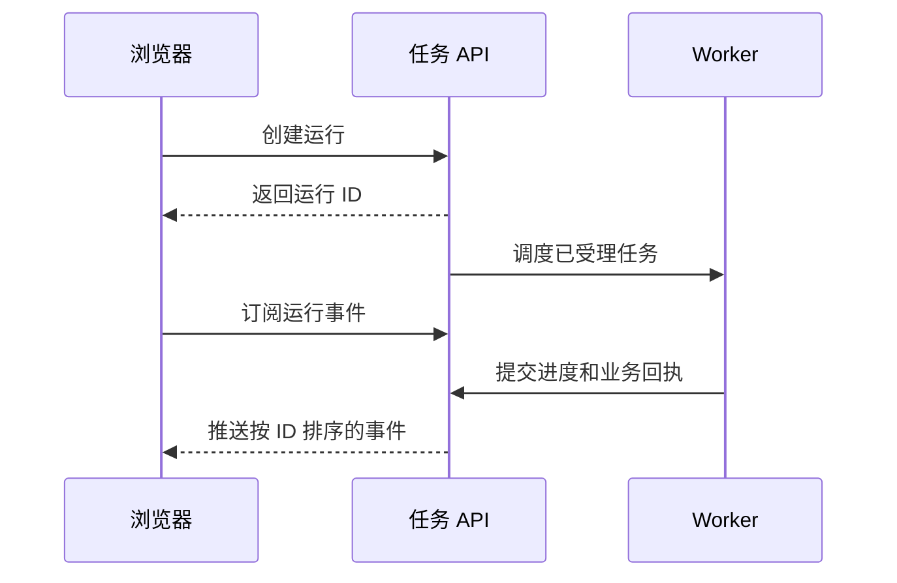

## 一次任务需要查询、推送和取消

客户提交政策核验后可以关闭浏览器，回来看到真实状态。服务可以用 REST 接受任务和状态查询，用 SSE 推送单向进度。在需要实时双向流的场景使用 WebSocket。先明确任务、连接和业务提交的身份，再用合适的传输表达。

| 接口示例 | 作用 | 重试与边界 |
| --- | --- | --- |
| `POST /runs` | 创建运行，返回运行 ID | 绑定请求主体及幂等键 |
| `GET /runs/{id}` | 返回权威状态和回执引用 | 每次检查租户及资源归属 |
| `GET /runs/{id}/events` | 订阅阶段进度和可回放事件 | 支持断线恢复与速率限制 |
| `POST /runs/{id}/cancel` | 请求取消 | 说明取消请求与实际终态的差异 |

## 如何实现可恢复流

对同一运行定义事件 ID 和事件类型，例如 `run.started`、`evidence.ready`、`run.completed`。SSE 原生 EventSource 重连时可带回 `Last-Event-ID`。服务回放之后可用事件，再切到实时流，并协调切换过程中的并发写入，防止快照和订阅之间漏事件。浏览器也应幂等呈现，避免同一条回执显示两次。事件过保留期时，用状态查询重新同步。临时 Token 可以不可回放，但有业务意义的状态变更必须可查。

FastAPI 的 SSE 接口可对照具体版本参考文档。经代理时需要实测缓冲、心跳、空闲超时和断线。WebSocket 提供双向通信，进度和最终结果仍须持久化。两种连接都检查主体、租户和任务归属，对每个身份限制同时连接数和回放量。模型或工具的敏感字段在事件发送前应按业务契约裁剪。

## 小结

任务状态以持久回执为准，流式接口用于观察。让连接可重建，让业务操作可核查，并用明确取消语义处理关闭客户端的情况。

## 参考资料

- [WHATWG HTML：Server-Sent Events](https://html.spec.whatwg.org/multipage/server-sent-events.html)
- [FastAPI：Server-Sent Events](https://fastapi.tiangolo.com/reference/sse/)
- [FastAPI：WebSockets](https://fastapi.tiangolo.com/advanced/websockets/)
