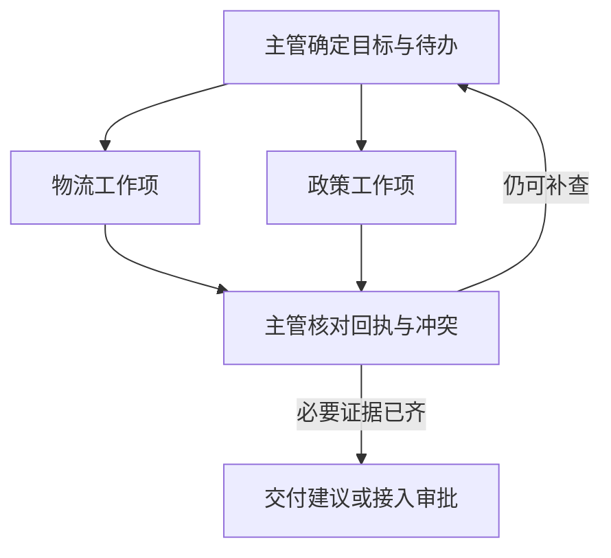

## 委派后的任务仍需要一个验收人

支持工单称「产品发货慢，还需要修改配送地址」。协调者先拆为只读核对物流、查询当前配送规则。修改地址是潜在副作用，必须依赖前置条件和另外的授权。Supervisor 负责分配与验收工作，工具执行器保留真正的权限判定。协调者不能把模型声明的「已完成」作为业务回执。

### 分派消息与回执是协议

请求消息包含任务 ID、版本、前置制品引用、所需能力、可使用工具范围、截止时间和成功条件。物流工作者可以返回 `found` 和运输状态回执，政策工作者可能返回 `blocked` 并说明缺少目的地地区。主管按工作 ID 标记待补信息并保留可用结果。若角色看到了更高权限数据，回执还要核对接收人的可见范围。

Supervisor 需要保存当前任务版本和工作分派状态。子 Agent 用独立产物提交证据，主管写任务级验收。子 Agent 重试后若报告相同结果，按稳定 ID 去重。若不同工作者重复提交同一工作项，比较当前版本和证据后保留一条可用结果，同时记录冲突。

### 从控制单点扩展到可恢复协调

主管逻辑不一定由一个长寿命模型会话执行。使用持久任务状态与接续机制，新的工作进程可读取待验收证据。如果主管成为瓶颈，先测队列、上下文长度和重复分派。可以分批合并、把固定决策移入规则、按权限域分层。评估时加上工作者拒绝、旧回执晚到和主管恢复三类故障，判断工作有没有丢失或重复执行。

## 小结

Supervisor 的关键职责是分派、验收和任务终止。先把输入、能力、权限和可核对结果写成工作项，再增加协调者的自动决定范围。

## 参考资料

- [Anthropic：Building effective agents](https://www.anthropic.com/research/building-effective-agents)
- [Wu 等：AutoGen](https://arxiv.org/abs/2308.08155)
