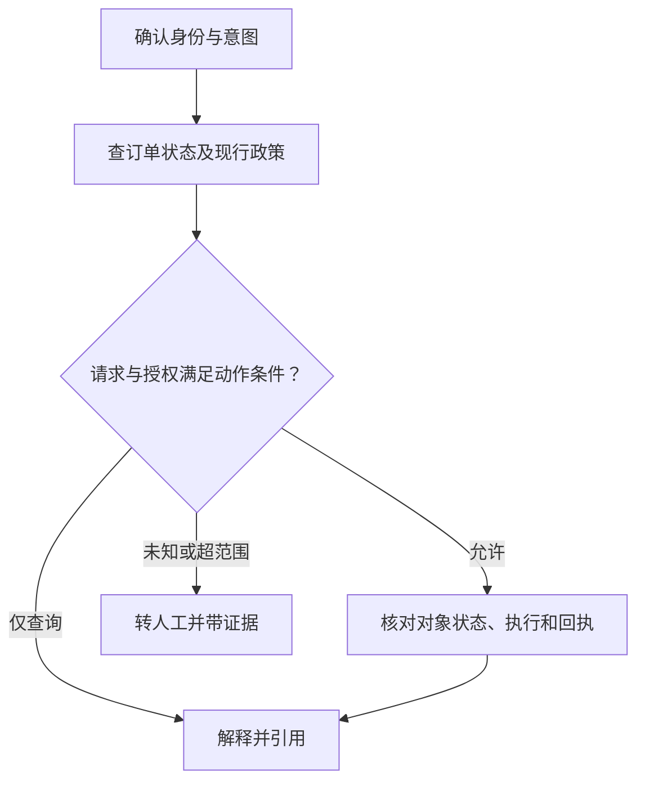

## 一个问题含两类信息和一个可能的动作

客户问「快递发出了吗，如果没有，能修改地址吗」。模型先辨别查询和动作意图。订单服务给实时状态，政策库给当前可用的改址规则。用户只询问能否修改时输出可核查建议；若用户另行确认具体目标，才进入有批准保护的改址流程。

## 状态变化会改变权限

假设查询显示订单尚在揽收前，用户确认了新地址。批准绑定订单身份与新地址摘要。执行前再次读取订单版本。如果订单已发出，则原条件发生变化，应依据当前政策转人工或说明不可修改。若提交超时，查询同一业务操作 ID，回传「待核对」而不是承诺完成。

政策片段、实时状态和实际回执分别留来源。避免把完整客户历史直接转给人工或记录进通用 Trace。人工接手看到问题、已核对证据、拒绝或等待原因，以及下一步该确认什么。

## 验收分清四类结果

测试样本覆盖正常咨询、政策换版、提交前状态变化和响应丢失。分别统计自主解决、正确转接、未经批准的动作和真实回执一致性。业务通常重视正确拒绝和真实完成率，不能只统计生成回复的条数。逐个复核变更状态的运行，确认没有同一动作重复提交。

## 小结

客服 Agent 把政策和订单事实连接到明确的状态机。工具真实结果决定完成，人工接管处理无法自动核对的边界。

## 参考资料

- [OpenAI：Evaluate agent workflows](https://developers.openai.com/api/docs/guides/agent-evals)
