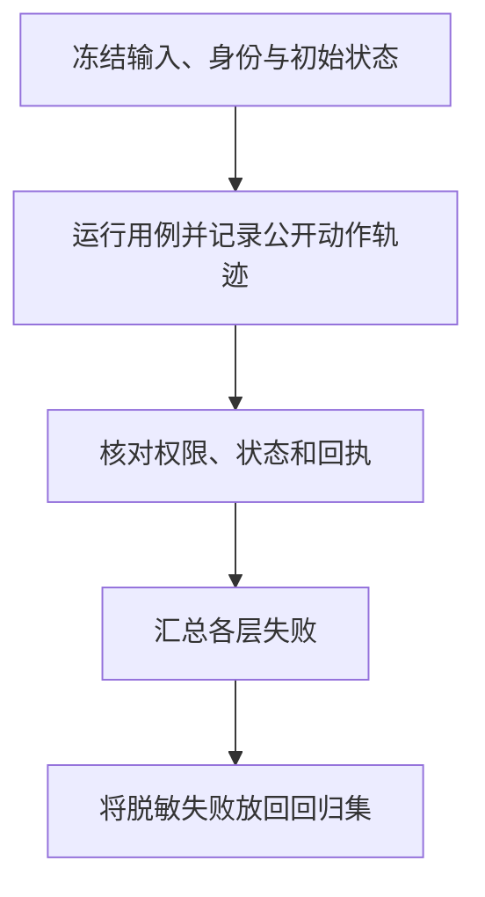

## 一条任务要验收哪些事实

员工需要核对某项政策并保存草稿。正确执行包括读取授权条款、匹配生效日、验证输入、取得批准并确认草稿回执。用测试替身控制模型和服务响应，可验证「请求、操作、回填、结束」每段。真实模型的判断波动则适合放进带版本的回归批次。先为测试用例确定主体、任务起始状态、受控证据、预期终态和禁止副作用。

| 测试层次 | 实例 | 核对点 |
| --- | --- | --- |
| 单元 | 验证审批是否与对象版本匹配 | 过期、缺失与冲突分别返回确定结果 |
| 集成 | 工具适配器返回拒绝或回执 | 消息关联、权限和异常映射 |
| 端到端 | 从 API 到受控业务存储 | 任务状态、回执、事件、重连可见 |
| 离线回归 | 用真实模型跑固定任务集 | 成功、正确澄清、拒绝、成本和波动 |
| 长任务演练 | 休眠审批、重启和重复派发 | 继续位置、租约、一次有效业务效果 |

## 用真实路径设计三组不同失败

第一组模拟只读工具超时，观察任务在预算内重试或交付部分证据。第二组模拟批准到达同时用户取消，核对只能由一个版本推进。第三组让业务替身成功写入后丢失回执，验证从检查点恢复时查同一操作 ID。把「是否调用工具」和「是否真的发生写入」分开记录。用于权限与注入防御测试的数据采用虚构合同和无副作用替身，验收关注越权动作不存在及拒绝状态能解释。

## 让测试结果能帮助发布决策

记录测试集版本、策略版本、候选与基线的配对任务，以及最早失败阶段。必要业务条件由确定性断言负责。语义质量可用经人工校准的量规，并把少量难例交人工复核。对同一随机模型重复运行，分别统计成功、超时和不可接受行为。上线门槛可以规定关键类零容忍，例如禁止任何未经批准的写入。易回归的检索与状态案例提高采样频率，其余样本按变更风险选择。

## 小结

按变更范围选测试层次，以真实或受控业务状态验收副作用，围绕恢复与边界构建回归样本。

## 参考资料

- [LangGraph：Test](https://docs.langchain.com/oss/python/langgraph/test)
- [OpenAI：Evaluate agent workflows](https://developers.openai.com/api/docs/guides/agent-evals)
