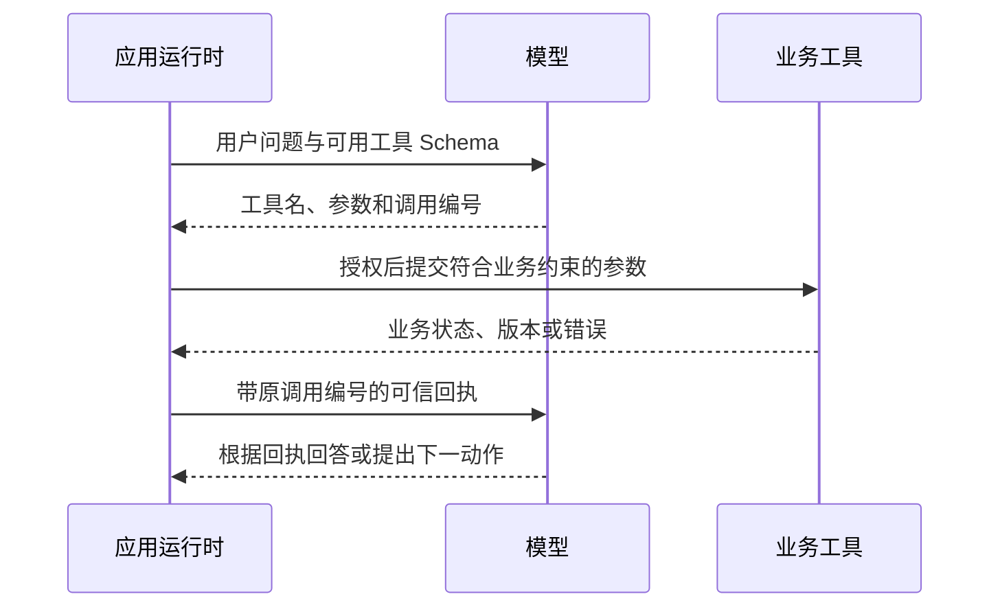

## 语言模型说「已经查到」时，实际发生了什么

用户问「报销单 C-27 到哪一步了？」模型自身无法读取业务数据库。宿主应用可以在请求中声明一个可查询单据的工具，并提供名称、用途、参数约束和返回说明。模型可返回结构化工具请求，宿主读取它、核对身份和单据、执行业务查询，再把回执交回模型。Function Calling 的价值是用协议表达候选动作，运行权仍由应用代码和业务服务掌握。

## 从 Tool Schema 到请求与回填

工具名称应反映意图，描述写清何时使用、何时不能用、每个字段含义及允许标识。JSON Schema 表示对象、字段类型、枚举和必填项。严格结构输出的能力和支持的 Schema 子集取决于具体 API。Schema 通过代表形状符合契约，可以减少解析错误。单据是否存在、属于哪个用户、可查询哪些字段，仍由业务层检查。

以 OpenAI Responses API 的工具调用语义为例，模型输出可含 function_call 项及其 call_id。应用执行后发送 function_call_output，将该回执关联到相同 call_id。其他接口返回名称、参数或调用标识的字段形状不完全相同，移植代码时应按所用 API 版本核对。一个请求可能提出零个、一个或多个调用；应用要处理全部批准的调用以及被拒绝的原因。若回执 A 误配到调用 B，模型可能用一个订单的状态回答另一个订单。

## 并行、重试与结果验证

两个互不依赖的只读动作可以并行。若必须先查单据才能知道下一个查询的成本中心，应先拿第一条回执，再用其 ID 发起第二条，不应由模型猜字段。写操作应先判断顺序、授权和重复执行后果，再决定是否并发。请求超时不等于失败，发生副作用的动作需要业务幂等键和结果查询。

工具回执可包含状态、受控字段、版本、错误类别和可信引用。空结果与请求被拒绝的意义不同。对金额等类型还需校验单位和币种，删除不必要的私密字段。工具输出里的文字属于环境数据，即使表达命令口吻也没有权力重新声明工具或权限。错误回执可提供可用于下一轮的具体缺失字段或范围，但不暴露内部凭据。结构化最终答复可以约束回答形式，实际工具结果仍必须以回执为准。

## Tool Registry 与运行时的分工

注册表负责声明能力、输入约束和接入实现。运行时按任务和授权生成本次允许的工具列表，执行实际校验和调用，保存回执和时间。工具数量多时可以先路由到较小集合，再由模型选择具体工具。过窄的路由可能漏掉所需能力，应提供未知或重选路径。[MCP](/agent-engineering/frameworks/#mcp) 为接入外部服务提供跨进程协议，业务调用仍服从宿主的授权、Schema 校验和验收。

## 小结

一次可靠的 Function Calling 包含可解释的工具契约、经校验的动作、可关联的回执和对结果的验收。模型提出动作，运行时决定是否和如何执行。

## 参考资料

- [OpenAI 官方指南：Function Calling](https://developers.openai.com/api/docs/guides/function-calling)
- [JSON Schema 参考](https://json-schema.org/understanding-json-schema/)
- [MCP 协议规范](https://modelcontextprotocol.io/specification/2025-11-25)
