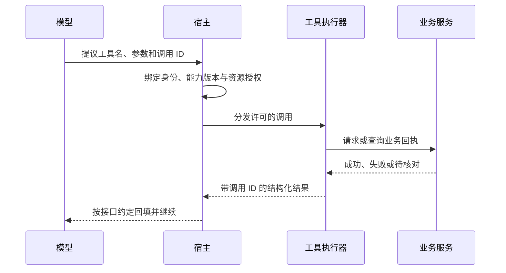

## 模型发出调用之后有三方职责

员工希望查 C-27 的状态、查看现行报销政策，并在有需要时提交说明草稿。模型可以同时提出 `get_claim` 和 `find_policy`。宿主必须决定这两个操作能否执行，以及实际完成后怎样把对应结果交给模型。业务系统负责对单号归属、规则版本和最终写入作权威判定。

Registry 存工具的稳定名称、版本、输入契约、读写性质以及调用适配器。工具发现应先按任务、身份和作用域筛选，再让模型在可用候选中选择。任务身份与可信租户由宿主注入，避免让模型输入中的 `tenant_id` 直接变成授权凭据。工具执行器领取一次具体调用，跑超时、授权、结果验证与记录。MCP 可以承载发现和调用，远程声明仍需进入宿主的工具信任与治理流程。

## 按调用 ID 建立一条可追踪链路

用同一轮的两个读取看并行细节。模型发出编号 `c1` 的单据查询和编号 `c2` 的政策查询。政策缓存先返回 `c2`。等待另一路成功后，宿主将结果关联各自调用，记录证据版本和时间，再按模型 API 规定提交结果。若 `c1` 返回拒绝，宿主保留拒绝状态，只暴露最少的失败信息。同时有旧政策和现行政策时，优先查询运行开始时明确的生效日期及允许范围。

| 工具请求关系 | 执行方式 | 需要守住的约束 |
| --- | --- | --- |
| 两路独立读 | 同批并发 | 并发上限、各自剩余时间和数据版本 |
| 查单得到报销类型后读规则 | 顺序 | 用可信上游结果补足下游业务条件 |
| 两项动作将写同一单据 | 用业务版本或锁串行协调 | 发现版本冲突后复核，避免覆盖 |
| 读取与写入引用同一草稿 | 写前复核最新状态 | 先前读取成功不能替代当前授权 |

## 把错误按可恢复性表达

结构无效时，给模型安全、具体的错误类型，允许在剩余预算内修正。权限拒绝后应等权限条件变化或更换可读对象。临时只读失败可退避重试，仍需尊重运行级截止时间。写入请求超时且结果未知时，需要单独的待核对状态。业务系统支持幂等时，跨模型调用与进程恢复应复用同一业务键。批准与工具参数绑定，关键参数变更后重新核对批准范围。

工具输出也属于外部数据。适配器应解析必要字段、控制返回大小，并为来源和失败类型保留可机读标识。模型可组织说明和提出下一步，最终动作资格与实际回执由运行时判定。验证并行路径时，至少覆盖回执乱序、部分失败、写后超时及授权发生变化四种情况。

## 小结

工具运行时把概率式工具选择转化成有主体、版本、结果和权限的操作。独立读可以有界并发。写入恢复必须围绕业务操作与可信回执建模。

## 参考资料

- [OpenAI API：Function calling](https://developers.openai.com/api/docs/guides/function-calling)
- [Model Context Protocol：Tools](https://modelcontextprotocol.io/specification/2025-11-25/server/tools)
- [IETF RFC 9110：HTTP 方法和幂等语义](https://www.rfc-editor.org/rfc/rfc9110.html#name-idempotent-methods)
