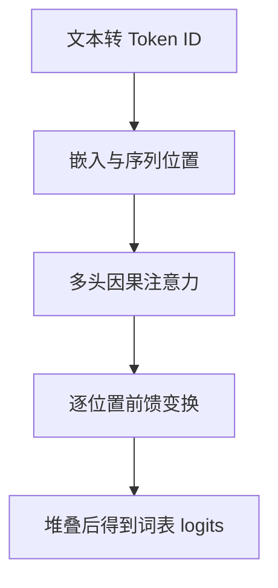

## 单看一个词，模型不知道它指什么

「把它移到 3 号库」中的「它」可能指上一句出现的设备。模型需要根据已有序列更新当前位置的表示。早期循环网络逐步传状态，Transformer 允许序列位置直接通过注意力读取其他位置的信息。在常见 decoder-only 模型中，因果掩码让每个位置在预测下一 Token 时只依赖当前和更早的输入。这是理解后续上下文长度、长输入成本和 KV Cache 的基础。

## Token、初始表示、Q/K/V

分词器把文本映射成模型词表中的 ID，子词、字节与字符可能混用。长度上限以模型 Token 为准，中文字符、代码和普通英文的 Token 比例不同。模型先查表得到每个位置的嵌入，再在多层网络中改写向量。和检索模型输出的段落 Embedding 不同，这些初始向量和后续隐状态是为下一 Token 预测学习的内部表示。

某层把传入向量分别投影成查询 Q、键 K、值 V。Query 表示当前位置想匹配什么。Key 描述各可见位置可被匹配的特征。Value 则是匹配之后实际读取的信息。它们通常由同一层输入通过不同的可训练矩阵获得。以一头为例，先算每个 q 与 k 的点积，除以键维度平方根，叠加因果掩码，沿可见位置做 softmax，最后用权重求 V 的加权和。

\[\mathrm{Attention}(Q,K,V)=\operatorname{softmax}\!\left(\frac{QK^\mathsf{T}}{\sqrt{d_k}} + M\right)V\]

如果位置 3 的查询在允许的前三个位置得分为 0、1、2，softmax 权重大致为 0.09、0.24、0.67。位置 4 在因果掩码下权重是零。点积按根号缩放是为了避免高维时分数过大，使 softmax 容易饱和。注意力权重能描述这一步的信息聚合，但不能直接证明生成结论依赖哪个原文，更不能替代来源引用。

## 多头、位置信息与前馈网络怎样配合

多个 head 使用不同的学习投影，各自进行注意力计算，再汇合和投影，可学习不同关系。不能笼统假定每个 head 都有一种固定且可解释的语言功能。注意力还需要知道词的相对或绝对顺序。原始 Transformer 使用正弦和余弦位置编码，一些模型使用可学习位置表示，许多当代解码模型使用 RoPE，将相应的 Q 和 K 按位置旋转，使注意力分数携带相对位置信息。在更长窗口使用位置扩展，仍需评估模型在长输入中的检索和依赖能力。

FFN 在每个位置上独立做非线性映射，相同层内位置共享参数。Attention 跨位置聚合，FFN 重新变换每个位置表示，两者加上残差连接与归一化堆叠成长网络。实际模型可能采用不同归一化位置、激活函数或专家结构。经过最后层后，输出头将隐状态变为对词表的 logits，按解码策略形成下一 Token。

## 在 Agent 中怎样使用这个知识

工具 schema、指令、检索证据和用户问题都会占输入长度。业务需要的是关键上下文可见、出处明确，以及生成时保留输出预算。强相关信息塞在很长输入中仍可能被忽略。理解因果注意力、位置约束和 Token 成本后，才能判断哪些信息要去重、哪些段落按任务排序，哪些应转为结构化追踪或外部检索。

## 小结

Token 提供输入单位，注意力由 Q/K 确定信息来源并聚合 V。多头、位置表示和 FFN 在堆叠层中形成含语境的隐状态，输出头把它映射到词表。

## 参考资料

- [Vaswani 等：Attention Is All You Need](https://arxiv.org/abs/1706.03762)
- [Su 等：RoFormer，Rotary Position Embedding](https://arxiv.org/abs/2104.09864)
