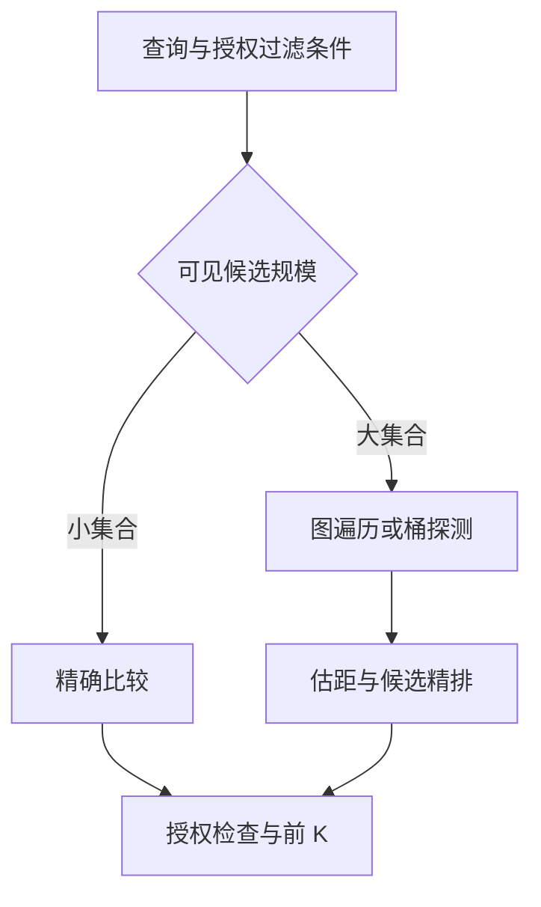

## 向量已经算好了，为什么还要建索引

把问题编码成向量后，可以逐个比较 100 万个片段。这样的精确搜索便于核对结果，但每次都要访问大量向量。以 100 万条 768 维 float32 为例，仅向量原始存储约 3.07 GB，未计索引、元数据与副本。向量库通常提供**向量索引**，让每次请求只比较有希望的候选，另负责任务过滤、更新、查询和持久化。索引与语义模型贡献不同，索引能找到高分邻居，能不能回答问题取决于向量、查询和证据本身。

## Exact Search 是基线，ANN 可以漏掉真实邻居

精确搜索计算可见集合内所有候选的分数，取真正的前 K。小集合、过滤后候选很少或做离线对照时，精确搜索往往可行。ANN（Approximate Nearest Neighbor）减少搜索范围或降低表示成本，换取更快或更省的搜索。评估时固定查询、向量、度量和过滤范围，把 ANN 的前 K 与精确前 K 取交集再除以 K，得到索引层的 ANN Recall@K。业务层 Recall@K 比的是人工标注证据，两者不能混用。一套索引可以完全复制错误的向量排序。

## HNSW、IVF 和 PQ 各改变哪一步

| 方法 | 原理 | 调节与代价 |
| --- | --- | --- |
| HNSW | 维护多层近邻图，高层快速移动，底层扩大候选搜索 | M 影响连接与内存，建图和查询的探索宽度分别影响构建成本和召回 |
| IVF | 用聚类中心划分向量。查询访问若干最近的倒排桶 | 桶数量影响每桶候选，nprobe 决定访问多少桶。漏掉边界桶会漏邻居 |
| PQ | 向量分成多个子空间，每段用码本编号近似，可用查表估计距离 | 字节数越小，内存越低，量化误差可能改变近邻排序 |
| IVF+PQ | 先探测少量桶，再用压缩码估距 | 可同时节省内存和比较次数，可对少量候选用原向量精排 |

HNSW 搜索从上层入口尝试向查询移动，再逐层下降，底层用比最终 K 更宽的候选集合探索。提高搜索宽度通常提高近似召回并增加 CPU 或内存访问。IVF 的中心在训练样本上生成，如果索引长期接收分布不同的新数据，桶可能严重失衡。PQ 是压缩技术，既可配 IVF，也可用于其他结构。压缩距离适合排序候选，但原向量精排只能纠正已经被找回的集合。

## 建图、分桶和编码分别保存了什么

**HNSW。** 为新向量随机分配最高所在层，越高层的节点通常越少。插入从入口点开始，先在高层贪心接近新向量，再在需要连接的各层寻找一组候选邻居。算法按距离和邻居选择规则保留有限连接，并更新相邻节点的连接。建图时的 `efConstruction` 增大候选探索范围，通常提高构建成本。查询时的 `efSearch` 决定底层探索的候选宽度，可在索引建成后单独调优。

**IVF。** 用代表性的语料样本对向量做聚类，形成 `nlist` 个中心。入库时把向量 ID 和必要的表示写到最近中心的桶。若查询靠近桶 A 和桶 B 的边界，距查询 0.12 的向量可能在 B，而 A 的最佳候选距查询 0.20。只探测 A 会漏掉真邻居。探测 A 与 B 让候选更全，同时增加访问和比较量。观察桶长度分布也重要，名义上的 `nprobe` 相同并不保证访问同样多的项。

**PQ。** 将一个 8 维向量切成 4 个二维子向量，每段训练 256 个聚类中心。每个子向量写入所在中心的 1 字节编号，因此每条只用 4 字节保存压缩码，原来的 float32 向量需 32 字节。码本、ID 和索引结构另计。用欧氏距离时，预先计算查询的每段与各个中心的平方距离，评估一条压缩记录时查 4 次表并求和。近似误差来自用中心替代真实子向量。IVF+PQ 可对粗中心残差编码，细节取决于引擎。

调优时先固定嵌入、度量和授权范围，使用精确排序作为对照。如果精确排序前 10 已经没有人工标注证据，先排查嵌入和索引数据。若精确前 10 有证据而 ANN 搜不到，再区分是否漏探桶、图探索宽度不足或压缩改写了排序。

## 带权限和版本的查询

如果先在全库取 20 个邻居，再丢掉无权限的 19 个，最终可能只剩 1 条，尽管可见集合里还有明显相关内容。检索的检查范围应来自服务端的身份和制度生效条件。引擎可能选择在索引内过滤、用分区缩小候选，或当范围很小时直接精确算分。带过滤的近似图搜索还需考虑连通性，具体策略因数据库而异。无论引擎怎样搜索，授权必须覆盖索引、上下文、原文回读和缓存，候选出了搜索服务前应做最终检查。

## 如何选型与上线

用当前数据和有代表性查询画出召回、P95 延迟、内存和更新压力曲线。覆盖不同过滤选择性，检查写入、撤权、删除、故障恢复和增量重建。记录索引代、向量契约与上游版本，用并行索引和固定数据快照验证迁移。业务量小，从精确检索起步最容易解释误差。高吞吐且内存充足时比较 HNSW，超大语料或内存受限时试 IVF、PQ 和精排组合。还要检查字段过滤能力、备份恢复、可用性和租户隔离。

## 小结

精确搜索提供可核对的近邻基线。HNSW、IVF 和 PQ 分别通过减少图搜索、缩小扫描范围或压缩表示交换成本，业务授权和证据相关性要独立验证。

## 参考资料

- [Malkov 与 Yashunin：HNSW](https://arxiv.org/abs/1603.09320)
- [Faiss：主要索引与存储成本](https://github.com/facebookresearch/faiss/wiki/Faiss-indexes)
- [Faiss：向量度量说明](https://github.com/facebookresearch/faiss/wiki/MetricType-and-distances)
