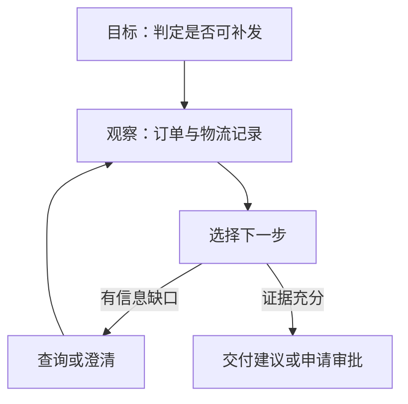

## 同一个售后入口可以有四种系统

用户说「包裹两天没更新，查一下是否可以补发」。聊天机器人可以解释补发政策。规则自动化可以根据已有状态在固定阈值下告警。带模型的工作流可以先解析订单号，再按预设分支查单、查政策、输出答复。Agent 则根据任务目标和实时观察，为当前情况提出下一步，例如识别已交接却无承运商扫描时补查物流，或提示用户补一个缺失字段。几种系统都能服务用户，差异最大的地方是**谁决定下一步**。

## Agent 的关键特征

这里的 Agent 指能在任务目标下根据观察选择动作、获取反馈和适时停止的系统。它需要可观察的环境、可用动作、可以更新的状态、决策过程，以及停止条件。环境可以是订单数据库、搜索系统或表单页面。动作包括询问用户、查订单、读政策、提交候选处理方案。动作造成的状态变化可能在环境中，也可能只是系统得到了新事实。只用工具一次、且顺序永远固定，并不足以体现动态行动。

实际产品的自主性有范围。Agentic System 常指含模型自治子步骤的整个系统，也可以在外层有确定性的鉴权、账务和审批流程。Autonomous Agent 一般强调在给定预算和授权内可以独立做更多决定。自主性可以分别按路径、时间、工具选择、操作影响和人工接管描述。一个系统允许自主规划三次查询，却规定所有退款须人工确认，仍是常见的设计。

## 用控制权与成本选系统

| 任务形态 | 下一步主要由谁决定 | 合理入口 |
| --- | --- | --- |
| 给出通用规则或引导 | 会话输入及固定请求处理 | 聊天机器人 |
| 已知输入、条件和执行路径 | 业务规则或确定性程序 | 传统自动化 |
| 路径清楚，某一步需要理解语言 | 工作流定义者，模型处理局部输入 | LLM 工作流 |
| 所需动作依赖上一轮观察 | 模型提出，运行时批准或拒绝 | 有界 Agent |

例如「订单超过 48 小时未扫描则告警」走固定规则。未知故障来源但可逐次检查数据时，可以让 Agent 选下一步，始终要有权限和次数限制。更长时间自主不一定更适合用户。问题可抽象为「附加决策是否增加任务成功，收益是否值得更多路径和验证成本」。

单 Agent 可以同时拥有多个工具。多 Agent 需要多个具有不同任务或决策职责的执行单元。一个模型连调查询、库存和优惠三个工具仍可能是单 Agent。若专门的物流调查和赔付判断各有决策状态与交接契约，再由主管汇总，就有多智能体协作。划分能隔离职责，但也会引入消息、重复工作和冲突处理负担。

## 小结

判断 Agent 首先看它是否能根据观察在运行时选择行动，以及这种选择在哪里受到束缚。先画出任务目标、环境、动作和验收，再比较固定工作流、单 Agent 或多 Agent。

## 参考资料

- [Anthropic：Building effective agents](https://www.anthropic.com/research/building-effective-agents)
- [Yao 等：ReAct](https://arxiv.org/abs/2210.03629)
