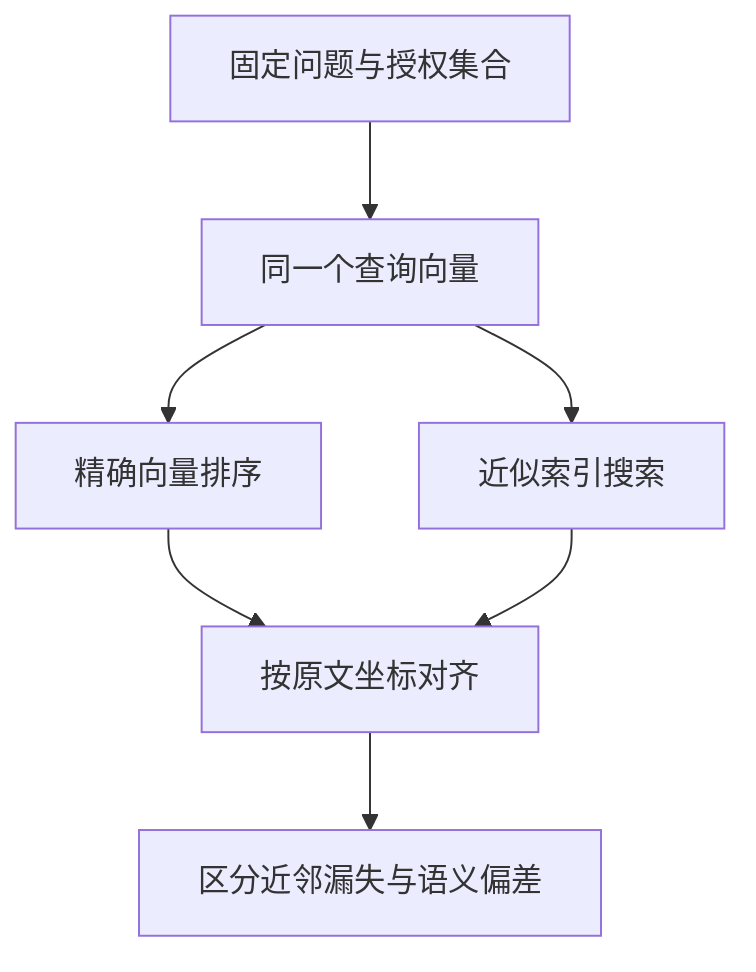

## 同义问法和错误码为什么会出现相反结果

内部手册写「终端登记超时后，在旧设备上解除登记」，用户问「换了电脑，登录校验卡住该怎么处理」。两者的词面交集很小；语义检索有机会把它们送到同一候选池。若用户问「E-014 与 E-041 有什么区别」，表示模型可能认为两段都在讲登记超时，却没有稳定地保留编号的精确匹配。两类问题可以用同一个实验定位，但经常需要不同召回策略。

## 从编码结果到候选文档

双塔检索在离线阶段编码文档片段，在线阶段编码问题，再按余弦相似度、内积或模型指定的方式比较。训练数据决定哪些问题和证据在向量空间里接近，分块决定编码器能看到哪些条件。索引根据这些向量寻找候选。在相同语料、可见范围、度量与前 K 的条件下，精确检索遍历全部向量，近似检索只探索部分，因此可以将前者用作索引对照。

## 一次可复现的故障定位

设一条问题的两段必需证据为 A 和 C，比较相同索引代、文档版本和可见集合内的前 3 条。下表为手工构造的演示数据。

| 查询方式 | 前 3 条 | 必需证据覆盖 |
| --- | --- | --- |
| 稀疏检索 | A、D、E | 1/2 |
| 精确向量排序 | A、C、B | 2/2 |
| 近似向量搜索 | A、B、F | 1/2 |

近似搜索命中精确前 3 中的 A、B，邻居重合率为 2/3。证据 C 在精确排序中位置靠前，优先检查索引搜索预算、过滤时机与向量版本。若 C 在精确结果中已排到第 20，则先看它的上下文是否被切掉、查询和文档是否按同一模型要求编码，再试混合检索或改进样本。两种误差都可能存在，调近似索引的探索范围通常只能解决其中一种。第 K 名出现分数并列时应固定排序规则，或单列边界并列样本。

权限过滤需要单独保留诊断。也许语料存着 C，但当前用户不应访问，正确结论就是缺证。若业务支持过滤索引，在授权范围内调候选数；如果索引实现需要先找近邻再过滤，授权集合稀疏时可能需要扩大初筛范围，并在资源交给下游前再次核对权限。对比方案要用真实可见范围跑分。

## 如何与 BM25、重排及生成配合

同义描述用 Dense 补齐，编号、专有词和错误码保留词法路径。先合并候选，再交给重排器识别真正回答问题的片段。验收时记录每路候选及融合后是否保留 A 和 C，再核对两者有没有进最终上下文。系统只有在最终答案使用了完整证据时才通过这一类任务。每层留出独立指标，线上一次掉分才有可追溯的归因。

## 小结

精确向量排序给出了同一表示下的对照，人工证据标注决定结果能否服务业务。分别核对近似搜索、可见范围和语义相关性，才能判断应该调整哪一层。

## 参考资料

- [Karpukhin 等：Dense Passage Retrieval](https://arxiv.org/abs/2004.04906)
- [Faiss：距离函数与向量度量](https://github.com/facebookresearch/faiss/wiki/MetricType-and-distances)
