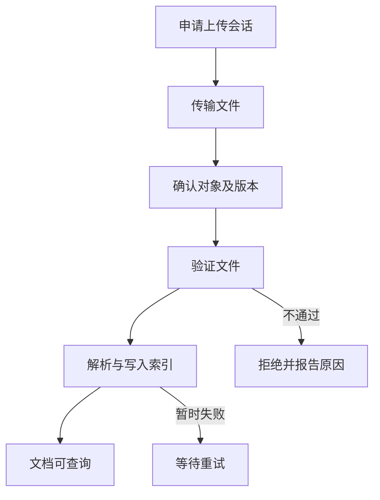

## 进度条到 100% 后，文档为什么还搜不到

用户把一份政策 PDF 上传到问答应用。浏览器能确定自己已经传完文件，却不知道服务是否确认了文件版本、解析器是否识别出表格，以及索引是否对当前用户可搜索。界面要明确区分上传进度和文档状态，否则用户重复点击时可能留下多个无法合并的资料副本。

## 把生命周期拆成两类状态

上传会话负责授权、对象键、允许大小、有效期和传输结果。应用任务负责验证、解析、索引和终止。服务创建会话时从当前登录身份确定租户与权限，并为每份文档生成受控的对象键。大文件可走对象存储直传，小型应用可让 API 代理上传。两种模式都需要由融合层查询可信的上传结果，并完成文件类型、大小、解析资源和安全检查。客户端提交的文件名与媒体类型只能作为显示或提示。

## 重连、重复提交和晚到回执

用户在上传完成后刷新页面，再次提交完成请求。应用按上传会话和已确认对象版本找到原任务，返回同一个任务 ID。若使用关系库与队列，可在确认上传对象的事务里一起写任务和待派发记录，提交成功后再由派发器调用队列。队列重复投递时，Worker 仍需按任务 ID 和对象版本去重处理。

浏览器打开页面后先读任务快照，然后订阅状态事件。断线用事件游标继续。事件已经过期时重新读取快照。页面收到旧的「解析中」事件时，以单任务的递增序号跳过它，避免状态从「可查询」倒退。遇到非兼容文件或大小超限时给出可行动的说明。暂时性服务故障显示为等待处理，重试成本和截止时间由后端控制。

## 文件删除怎样传到索引

文档删除后，查询和下载入口先检查文档是否仍有效，随后异步清理对象、解析副本、向量和缓存。以对象版本或索引代绑定异步结果。旧 Worker 晚于删除提交时，应发现版本已失效，避免把该文件重新发布。读者可以沿一个案例验证三处边界：另一账号能否提交该文件的状态，上传回执重复时会不会生成两份任务，删除后晚到的处理结果会不会复活文档。

## 小结

对象传输、文件验证和知识索引各自拥有状态。浏览器展示任务契约，后端掌握授权、版本和发布条件，解析结果由当前文档版本决定能否进入检索。

## 参考资料

- [OWASP：File Upload Cheat Sheet](https://cheatsheetseries.owasp.org/cheatsheets/File_Upload_Cheat_Sheet.html)
- [WHATWG HTML：Server-sent events](https://html.spec.whatwg.org/multipage/server-sent-events.html)
