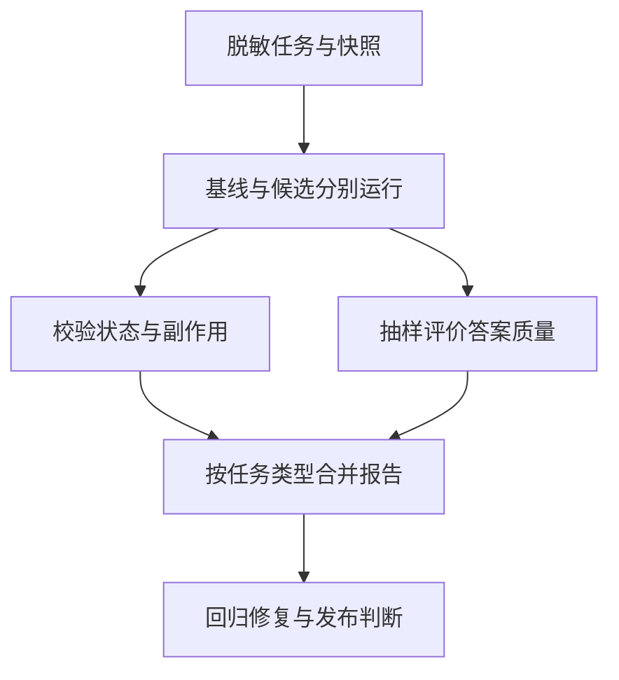

## 两个版本都说「处理完成」

一个工单 Agent 回复用户「已补齐材料」，却写进了另一条工单。另一次，它对正确工单提交材料，最终答复缺了回执编号。只让模型给回复打分，两个错误可能都被判为表述问题。把评测建立在业务状态上，才能把越权写入和回复缺项分开处理。

## 从线上轨迹定义样本

把轨迹拆成任务、环境和评分。任务包括用户意图、身份范围和时间条件。环境提供脱敏的工单、文件和政策快照，还应能针对超时或回执丢失重放同一状态。评分记录期望副作用、禁止的行为和可选的证据路径。用户允许询问或转人工时，按是否采取合适动作计分，避免把唯一一条工具序列当作参考答案。

## 评分器应当按职责组合

精确条件优先用程序校验，例如记录归属、状态是否变化、写入次数和引用能否定位。答案质量适合使用带示例的量表，如「已经回答任务范围」「引用足以支持结论」「遇到缺证作出恰当说明」。将录入评委的答案去掉版本名称，成对交换顺序，并和独立人工评分对照。发生分歧时保留评委理由、顺序和证据，让复核者能定位是规则歧义、样本问题还是评委偏好。先校准评委在具体业务上识别失败的能力，再考虑扩展覆盖。

假设 50 个有人工判断的答案中，10 个实际未通过，而模型评委只识别出 4 个。即使它在其余 40 个都给出正确通过，总一致率仍有 88%，对失败的检出率却只有 40%。这时，模型评分可用于筛选待复核样本，发布门槛仍由可核验条件和人工抽查提供依据。

## 用成对差异决定是否发布

对同一快照和相同任务运行两版。假设 100 个任务里，现版成功 78 个，候选成功 82 个，其中 9 个改善、5 个回退。分别报告这 14 个变动，并记录剩余样本与两版各自的环境失败。若回退里有一条越权写入，应阻止发布并复跑该切片。将回归集与日常改进集分开，对不稳定模型可为关键任务安排多次运行。报告应包含每条切片的样本数、版本、异常排除规则和延迟成本。如果样本过少，公开记录不确定性并增加抽查。

## 小结

可靠评测把「完成任务」「遵守行为边界」和「解释答案」评价在各自的证据上。运行成对对照，并优先排查新出现的严重回退。

## 参考资料

- [Yao 等：τ-bench](https://arxiv.org/abs/2406.12045)
- [Zheng 等：Judging LLM-as-a-Judge](https://arxiv.org/abs/2306.05685)
