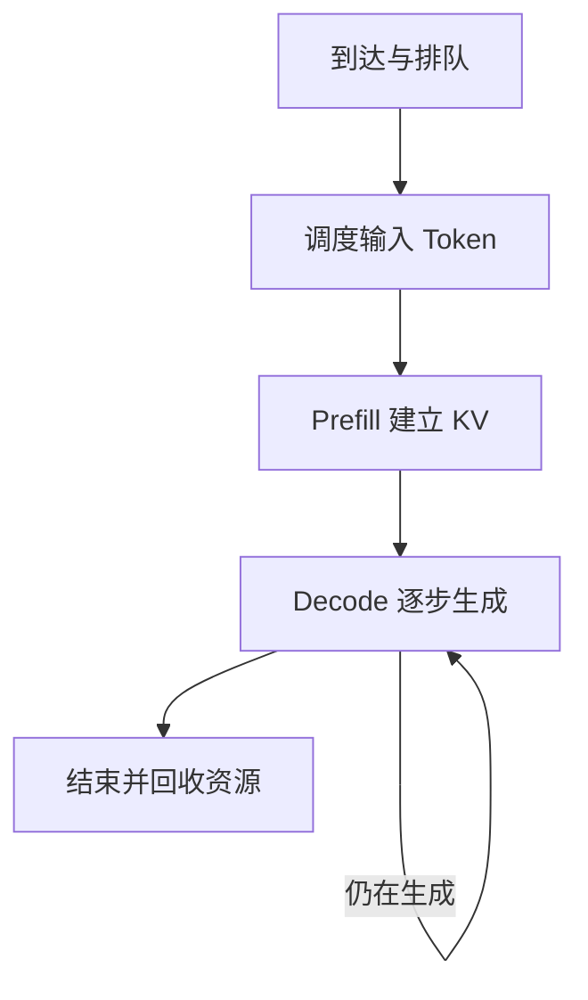

## 为什么一份长文档会让短问题等得更久

团队的内部助手接收政策问答和文档摘要。两类请求用同一个模型。摘要输入 12,000 Token，简短问答输入 400 Token。两者都只生成几十个 Token。高峰期，短请求的生成速度没有明显变慢，首字却明显延后。先在同一 Trace 里拆开排队、预填充和输出间隔，再确定要调模型、GPU 还是调度。

## 一次请求如何占用推理资源

Prefill 处理输入并建立缓存。Decode 根据已有缓存逐步生成 Token。请求持续输出时，KV Cache 随已处理序列增长。固定批次可以一起执行请求，但短请求结束后的槽位需要由调度器及时回收。连续批处理在迭代间接纳新请求，在 GPU 利用率和单请求等待之间调整。分块 Prefill 可以将大输入拆成有限预算的调度片，避免一次长输入占满迭代资源。分块会改变该请求何时拿到首 Token，需要分别观察长短请求。

## 怎样用可复算的例子估容量

对于每层都保存完整 KV 的演示模型，一条未共享缓存的序列每 Token 的 KV 字节约为「2 × 层数 × KV 头数 × 每头维度 × 每元素字节数」。假设 32 层、8 个 KV 头、每头 128 维、BF16 占 2 字节，每 Token 约 128 KiB，8192 Token 约 1 GiB。若独立 KV 的预算是 12 GiB，12 条这样长的序列就会碰到理论上限。真实服务还会受缓存块、非模型显存、调度余量、激活和并行分片影响。共享前缀或滑动窗口可改变估算前提。

不要拿 GPU 总显存直接除这个公式。先测量固定模型权重和运行时开销，再看缓存池实际占用及回收。PagedAttention 用块组织 KV 以减少碎片，并支持特定情形的共享。权重量化可以给缓存腾出空间，KV 精度则需要单独配置和评估。

## 怎样把容量结论带回部署

用实际输入及输出长度分布做负载，记录队列深度、GPU 压力、缓存块占用、首 Token 时间与 Token 间隔。对照三种流量：稳定短请求、短长混合、长请求集中到达。若首字慢但输出间隔稳定，先评估调度、入口限额与长短隔离；若所有批次的 Decode 都慢，再检查批规模、硬件带宽和模型配置。报告应列出 P95 和样本量，也要保留超时与取消样本，避免只对完成的请求统计。调度有界、可观测、能预期地回收资源之后，才适合扩大业务流量。

## 小结

排队影响首字，逐步生成影响输出节奏，序列长度影响缓存容量。把三者分别测量，再调整调度、模型或资源。

## 参考资料

- [Yu 等：Orca](https://www.usenix.org/conference/osdi22/presentation/yu)
- [Kwon 等：PagedAttention](https://arxiv.org/abs/2309.06180)
